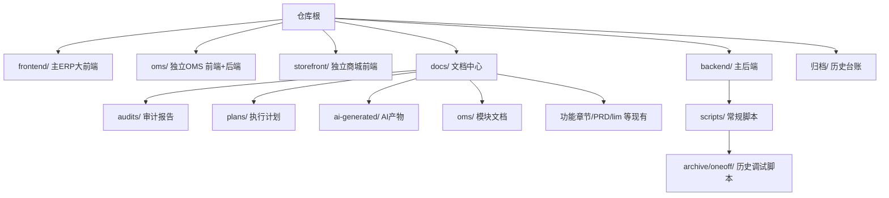

## 用户需求
用户对跨境电商系统项目的目录结构感到"很乱",希望获得一份完整的架构清理计划。经确认:用户此前要求"更新到 main"实为查看差异(未改动);随后选择方案 A——生成完整架构清理计划。当前处于 plan 模式,本计划仅描述方案,确认后才执行。

## 产品概述
本次为**仓库结构治理**,不改变任何业务代码与运行逻辑。目标是消除"视觉上很乱"的观感,让项目层次清晰、文档可检索、调试残留可控。清理后仓库仍保持双前端(主 ERP 大前端 `frontend/` + 独立 OMS 门户 `oms/`)的合理架构,不合并。

## 核心特征
- 文档归位:根目录散落的 8 个审计/计划 md 移入 `docs/audits/` 与 `docs/plans/`;`docs/superpowers/`(AI 工具产物)归并为 `docs/ai-generated/`
- 一次性脚本清理:`backend/scripts/oneoff/` 下 20+ 个 `probe_*`/`seed_*` 调试脚本移入 `backend/scripts/archive/`(保留可追溯,不删历史痕迹)
- 删除误留的临时文件根目录 `_git_run.bat`
- 补一份"仓库结构与文档索引"到 README,明确各目录职责与文档去处
- 磁盘噪音(node_modules/dist/.log 等未跟踪产物)仅提供清理命令清单,默认不自动删,避免误伤


## 技术栈与约束
- 纯 git 仓库结构治理,涉及 `git mv` / `git rm --cached`(如需) / 目录移动 / 文件编辑,无新技术栈引入
- 现有 `.gitignore` 已正确忽略 `node_modules/`、`dist/`、`.log`、`*.zip`、`lab/`、`outputs/`、`.idea` 等,**无需修改**
- 关键事实(已核实):git 跟踪文件仅 **680 个**;所谓"2 万文件"是未跟踪的构建产物,不影响仓库

## 实施策略
1. **文档归位(低风险,用 `git mv` 保留历史)**
   - 根目录 6 个审计报告/注册类 md → `docs/audits/`(BUSINESS_FLOW_AUDIT、CODE_REDUNDANCY_AUDIT、INTEGRATION_GAPS、REPAIR_BACKLOG、E2E_TEST_REPORT、MOCK_DATA_REGISTER)
   - 根目录 2 个中文计划 md → `docs/plans/`(开发执行计划、第一批执行说明)
   - `docs/superpowers/` → 重命名为 `docs/ai-generated/`(仅改目录名,内容不动)
2. **一次性脚本归档**:`backend/scripts/oneoff/` 整体移入 `backend/scripts/archive/oneoff/`,README 注明其为历史调试脚本
3. **临时文件删除**:删除根目录 `_git_run.bat`(未跟踪,直接 `del`)
4. **README 增补**:新增"仓库结构"章节,列明 `frontend/`(主 ERP)、`oms/`(独立 OMS)、`storefront/`(商城)、`backend/`(主后端)职责,及文档索引(`docs/audits`、`docs/plans`、`docs/ai-generated`、`归档/`)
5. **磁盘噪音清理(可选,不默认执行)**:提供 `git clean -xdn` 预览 + 人工确认后再 `git clean -xdn` 的清单说明

## 实施注意事项
- 所有移动用 `git mv`,确保 git 历史连续,不产生"删除+新增"假象
- 不触碰 `frontend/` 与 `oms/frontend/` 的代码(独立系统,README 已说明)
- 不删除 `lab/`、`outputs/`、`.idea/`(已被 gitignore,未跟踪)
- 根目录 3 个 `.zip` 未被跟踪,列出供用户自行决定是否删除,不在自动步骤内
- 不执行 commit/push(除非用户后续明确要求)

## 架构设计


## 目录结构(将修改/新建的文件)
```
跨境电商系统开发/
├── README.md                              # [MODIFY] 新增"仓库结构"与"文档索引"章节
├── docs/
│   ├── audits/                            # [NEW] 接收根目录 6 个审计报告 md
│   ├── plans/                             # [NEW] 接收根目录 2 个中文计划 md
│   └── ai-generated/                      # [NEW,由 docs/superpowers/ 改名] AI 工具生成物
├── backend/scripts/
│   └── archive/oneoff/                    # [NEW] 接收 backend/scripts/oneoff/ 全部调试脚本
└── _git_run.bat                           # [DELETE] 误留的临时文件(未跟踪)
```
根目录待移走的 8 个 md:`BUSINESS_FLOW_AUDIT.md`、`CODE_REDUNDANCY_AUDIT.md`、`INTEGRATION_GAPS.md`、`REPAIR_BACKLOG.md`、`E2E_TEST_REPORT.md`、`MOCK_DATA_REGISTER.md`、`开发执行计划.md`、`第一批执行说明.md`

## 关键执行命令(参考)
- `git mv BUSINESS_FLOW_AUDIT.md docs/audits/`
- `git mv docs/superpowers docs/ai-generated`
- `git mv backend/scripts/oneoff backend/scripts/archive/oneoff`
- `del _git_run.bat`
- 磁盘噪音预览:`git clean -xdn`(仅展示,不删)


## Agent Extensions
### SubAgent
- **code-explorer**
  - 用途:在清理前二次确认 `backend/scripts/oneoff/` 各脚本是否被其他代码 import 引用,避免误归档仍在使用的脚本
  - 预期结果:产出"可安全归档"清单,确保移动不破坏运行链路
