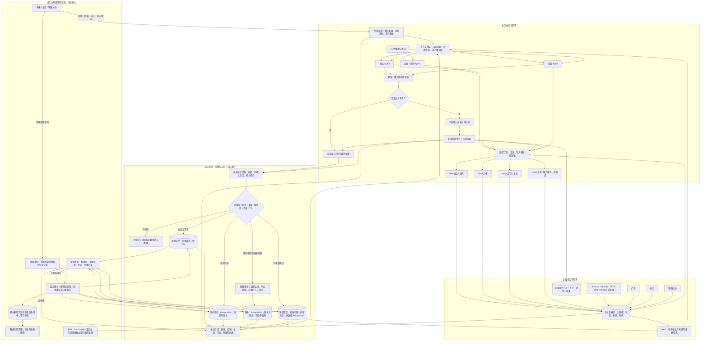

# AI 总助手与多 Agent 目标架构

> 本文将用户提供的示意图整理为**目标架构**。它描述后续开发方向，不代表图中所有系统和平台已经接通。

## 总体关系与记忆完整流程

Amazon、Shopify、TikTok Shop 和 Shopee 是**并列的销售渠道**。建议各自经渠道适配器进入企业数据层，统一映射成店铺、Listing、订单、库存和财务记录；不应按图形的纵向位置理解为 Amazon 依次调用其他平台。

图中“记忆”是**目标设计**，不是当前已经上线的功能。企业数据层保存订单、库存和采购等权威业务事实；记忆只保存有来源、用途和有效期的可复用上下文，不能替代业务单据，也不能改变账号权限。

| 内容 | 目标存储位置 | 保存与更新规则 |
| --- | --- | --- |
| 当前会话上下文 | 会话缓存，短 TTL | 会话结束或到期清除；不默认转为长期记忆 |
| 任务经验与已确认偏好 | PostgreSQL 专用记忆表 | 记录主体、店铺范围、来源、确认状态、版本和到期时间 |
| 用户或店铺画像 | PostgreSQL 版本化画像表 | 先形成候选，再核对证据和冲突；画像不授予权限 |
| 已审核的业务知识 | 原文存对象存储；向量索引供检索；元数据存 PostgreSQL | 来源变更时重建索引，撤回时同时清除原文与索引 |
| 订单、采购、库存等正式业务记录 | ERP / OMS / WMS 业务数据库 | 遵循独立业务及法定留存规则，不因“忘记聊天”而直接删除 |
| 删除凭证 | 受限审计记录与备份恢复清单 | 只记删除范围、时间、执行结果；不保留被遗忘的原文 |

生命周期是**候选 → 校验 → 生效 → 复核 → 更新、归档或遗忘**。回答前只召回当前用户与店铺有权访问、用途相符且未过期的记忆。用户要求遗忘时，先核验身份与范围，再清理主存储、缓存、检索索引；备份按保留周期退出，若在此之前恢复备份，必须重放删除清单，防止被忘记的内容重新出现。

## 三类 Agent 的职责

| Agent | 第一阶段可做的事 | 后续能力依赖 |
|---|---|---|
| 商品 | 查询本地商品、SKU、Listing 映射，说明库存和供货价 | 真实平台 Listing 同步、市场与竞品数据；选品和定价还需成本、利润和约束规则 |
| 运营 | 查询订单、库存、采购、补货及现有看板，解释异常 | 广告数据、平台结算、物流轨迹、可配置告警和完整报表 |
| 客服 | 查询订单、售后、客服工单，拟定回复草稿 | CRM 客户画像、平台消息 API、承运商轨迹；对外发送回复须经授权 |

AI 总助手负责识别问题、按账号权限选择工具、调用适当 Agent，并给出带来源和时间范围的答案。需要修改价格、退款、调整库存、发消息等动作时，先形成可核对的操作内容，再由有权限的人员确认执行；执行结果写入审计日志。

## 与当前项目的对应情况

| 目标能力 | 当前状态 | 代码或页面入口 |
|---|---|---|
| ERP 商品、SKU、Listing 本地映射、采购 | 已有本地接口和页面 | `frontend/src/pages/Products.tsx`、`ListingsPage.tsx`、`Purchase.tsx`；`backend/app/listings.py`、`scm.py` |
| OMS 订单及售后 | 已有本地接口和页面 | `backend/app/orders.py`、`frontend/src/pages/Orders.tsx`、`AfterSalesPage.tsx` |
| WMS 库存、出入库、FBA 本地发货计划 | 已有本地接口和页面；FBA 未连接 Amazon | `backend/app/wms.py`、`fba.py` |
| 客服工单 | 已有内部工单流转；尚无完整 CRM 客户主档和平台消息 | `backend/app/customer_tickets.py` |
| 企业经营数据 | 有本地业务数据库和 DataLab 看板代理；尚未形成统一 AI 数据服务 | `backend/app/datalab.py`、`frontend/src/pages/Dashboard.tsx` |
| Amazon、Shopify、TikTok Shop、Shopee | 已有渠道连接与订单镜像框架；真实平台主动拉单适配器尚未接通 | `backend/app/channels.py`；现有订单不能仅凭渠道字段证明来自平台同步 |
| 广告、财务、统计 | 已有 DataLab 有限行数的只读页面；完整业务管理与对账未完成 | `frontend/src/pages/AdCampaignsPage.tsx`、`FinanceSettlementsPage.tsx`、`StatisticsPage.tsx` |
| 物流轨迹 | 本地出库与 FBA 可记录追踪号；没有承运商实时轨迹 | `backend/app/wms.py`、`fba.py` |
| LLM、RAG、AI 总助手及专用 Agent | 采购 Agent 已有独立模型调用；AI 总助手提供商品/运营/知识查询工具。商品与运营 Agent 有独立只读问答 API 和页面；客服 Agent 有工单专用草稿 API 与页面，复用规则匹配、证据引用和管理员审核流。语义向量检索、文档版本/失效管理及本图记忆治理仍未实现 | `backend/app/assistant.py`、`product_agent.py`、`operations_agent.py`、`agent_generation.py`、`assistant_catalog.py`、`assistant_operations.py` |

“企业数据层”不能只把数据库表拼在一起。至少需要为订单、商品、客户、仓库、广告、财务定义统一 ID、来源渠道、更新时间、币种与状态口径；同时记录源数据与同步错误，避免 AI 把不同店铺或不同币种的数据混算。

## 建议实施顺序

1. **只读问答：**已交付首版与增强版。总助手可查询商品/SKU、Listing 本地映射、当前供应关系、订单、库存、采购单和客服工单；另有运营状态快照。服务端按对应读取权限及店铺/仓库范围过滤；权限不足会区分为不可用，不会伪装成空数据。不会执行写入；客服查询不向模型提供工单主题、描述或客户联系方式。每次请求只保留当前轮上下文，不保存长期聊天记忆。非管理员需要管理员授予 `assistant:read`，并同时具备所查询业务的读取权限。摘要会发送到后台配置的模型服务。
2. **企业知识检索：**本地功能章节与 OMS 文档的关键词检索首版已接入总助手，答案可查看章节、文件、行号与原文片段；下一步再做文档版本/失效管理、审核规则纳入，以及语义向量检索和检索评测。
3. **专用 Agent：**商品、运营、客服三个专用入口/API 已完成首轮交付。商品与运营保持只读；客服基于工单和已发布规则生成带引用草稿，并进入管理员审核，不自动发送。下一步为三类 Agent 增加场景验收测试、运行记录/失败恢复与独立评测；总助手与专用 Agent 共用受控业务服务。
4. **外部平台连接：**按业务价值逐个接入渠道、物流、广告及结算数据，建立同步状态和数据质量监控。每个平台独立适配。
5. **受控执行：**在角色权限、店铺/仓库数据范围、幂等校验和审计完整后，逐步开放价格变更、客服回复或补货建议等写入动作。

## 首个可交付场景

用户问：“美国站最近有哪些订单待发货、库存够不够？”总助手先识别店铺与时间范围，读取账号有权访问的订单和库存，再按 SKU 与仓库核对可用量，返回待发货订单、缺货项、数据更新时间及对应订单链接。若权限不足或数据不完整，明确指出缺失，不猜测数字。

这个场景可复用当前 OMS、WMS 和店铺权限。只读总助手首版已经提供入口和 API；这个具体的跨订单与库存按 SKU 联合核对场景仍需补齐，再进行真实业务验收。
