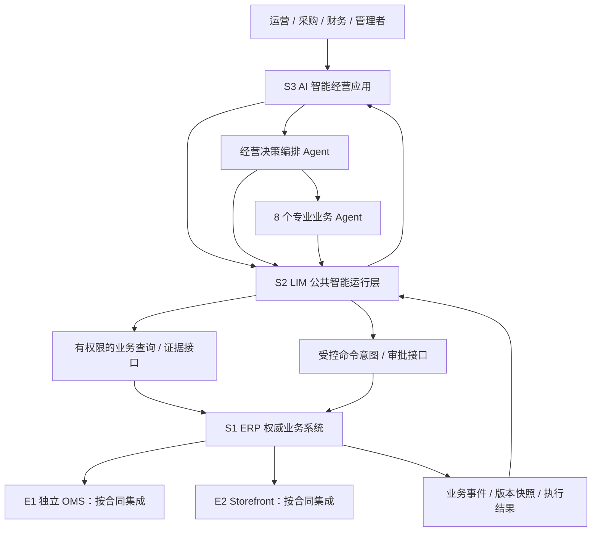
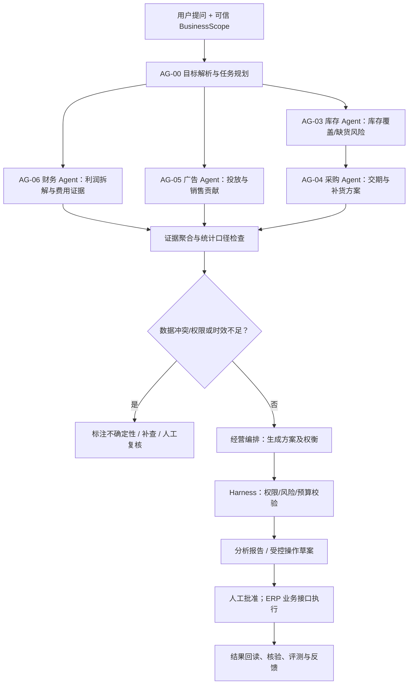
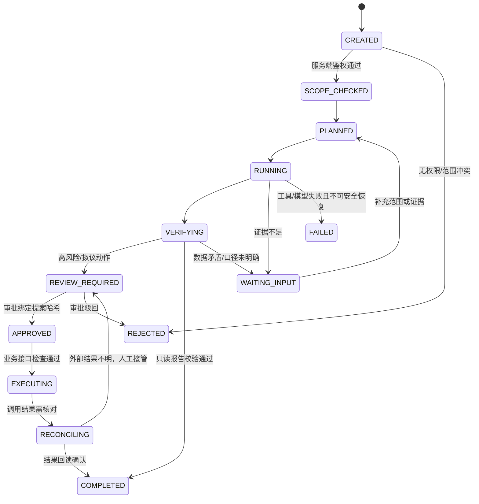
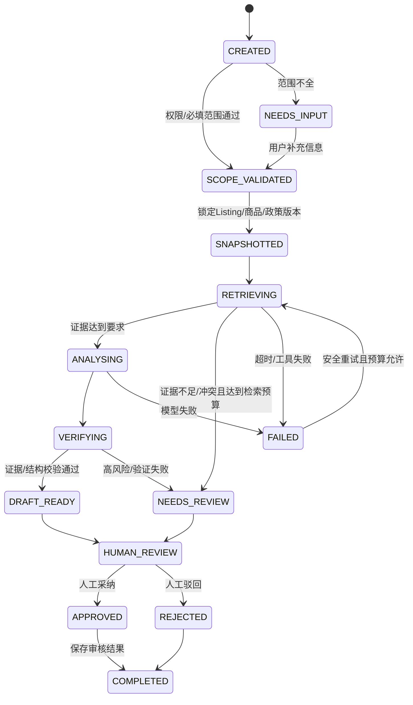
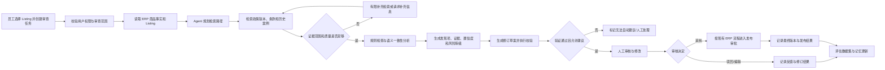

# LLM 原生跨境电商 ERP：企业级系统架构、Agent 协同与存量需求对齐 v0.3

> **版本**：v0.3 · **修订日期**：2026-10-20 · **状态**：架构与需求修订草案（尚待运行验证、接口盘点、试点验收）  
> **修订依据**：《LLM 原生跨境电商 ERP 上层应用需求 v0.1》、v0.2 存量能力对齐文档、《现有功能清单（需求对齐用）》（2026-10-20）及后续系统架构讨论。  
> **证据等级**：本版仅根据已提供文件和讨论确定现有能力、设计目标与建议，不声称已运行源码、连接真实 Amazon API、执行自动化回归测试或实现完整生产级 LIM。  
> **版本说明**：本版明确 **3 个核心逻辑系统、2 个可选/既有扩展系统、9 个规划 Agent**，同时保留原有 Listing 政策审核纵切、存量代码复用和企业级长期研发目标。

## 0. 执行摘要与版本决策

### 0.1 项目最终定位

**面向跨境电商经营场景，依托既有 ERP 业务底座，建设可解释、可评测、受控执行的多 Agent 智能经营平台。**

核心流程：**业务事实（ERP） → 跨域理解与决策（AI 应用） → 通用智能运行与治理（LIM） → 受控业务操作（ERP） → 结果核验与经验反馈**。

系统不是从零搭建的单点聊天机器人：已有订单、商品、库存、采购、FBA、财务、广告等业务实现，也已有受控查询、采购/Listing/客服等 AI 功能。下一阶段以**统一运行底座、协作闭环与生产级验证**为重点。

### 0.2 已确定的逻辑规模

| 项目组成 | 规划数量 | 规划角色 | 是否等于独立部署/已经完成 |
|---|---:|---|---|
| 核心系统 | **3** | ERP 业务系统；LIM 智能中间层；AI 智能经营应用系统 | **不等于**三套必须独立部署的服务；完成情况按能力验收 |
| 扩展系统 | **2** | 独立 OMS；Storefront 独立站 | 已有独立实现/演示，但**不等于**自动并入 ERP 或生产上线 |
| 业务 Agent | **9** | 1 个经营编排 + 8 个业务专业 Agent | 是**逻辑角色规划**，非 9 套服务或 9 个都已实现 |
| LIM 横向能力 | 若干共享组件 | Runtime、工具、检索、记忆、网关、Harness、观测、评测 | **不是**额外业务 Agent；按现有能力与缺口增量建设 |

### 0.3 分清三种状态

- **已有实现（待验收）**：仅限功能清单中 B01–B31、A01–A12 的明确描述；有源码、页面/接口依据，不能直接等同生产验收。
- **部分实现／模拟／独立演示**：P01–P07、O01–O07、S01–S06；明确 mock、DataLab、真实同步、外部写回、支付和履约限制。
- **目标需求（尚不能宣称完成）**：统一 LIM、经营编排、多 Agent 协同、时态 GraphRAG、可信经验记忆、全链路评测、真实平台安全执行等。

## 1. 项目背景、目标用户与业务价值

### 1.1 业务背景

跨境电商经营涉及平台店铺、Listing、订单、库存、采购、FBA、广告、售后与资金结算。传统 ERP 的优势是记录事实和执行业务状态机，但很多重要问题跨越多个模块：例如**销量提高却利润下滑**，可能同时涉及广告花费、退款、平台费用、采购单价、库存和到货时间。单模块看板或孤立业务助手难以直接形成完整、可复核的行动建议。

另一类问题是**政策版本与商品事实一致性**：一段 Listing 声称的商品属性是否与 SKU 主数据一致；不同国家、品类与生效时间下，应引用哪份政策、哪一条规则。纯文本生成与孤立检索存在错误版本、证据冲突、事实编造和发布风险。

### 1.2 从已有系统演进，而非重复造 ERP

项目已有较广的业务 CRUD、审批、数据核算和多个 AI 场景。当前痛点因此从“缺少 ERP 系统”变为：

1. 业务数据分散、真实性与更新时点不同，跨域推理易产生误关联。
2. 既有 Agent/助手重复处理模型调用、工具协议、状态、审批及证据，缺乏统一的可评测运行边界。
3. 经营建议可能与库存、利润、采购与政策约束发生冲突，需要跨 Agent 校验。
4. 真实平台连接、第三方副作用、数据质量与运行稳定性尚有待按场景验证。

### 1.3 面向的使用角色

| 用户 | 主要任务 | 代表智能场景 |
|---|---|---|
| 运营/商品管理 | 商品、Listing、活动日常管理 | Listing 属性与政策审查、经营异常解释 |
| 广告运营 | 广告投入与效率 | ACOS/ROAS 异常解释并结合库存和利润建议 |
| 采购与供应链 | 采购、交期、供应商、FBA | 供需缺口、补货方案、供应商报价风险 |
| 客服/售后 | 工单、退货、退款 | 汇总共性问题、合规回复草稿 |
| 财务与管理者 | 费用、结算、利润、经营决策 | 利润拆解、账单证据核对、跨域方案审批 |
| 系统管理员/审核人 | 数据访问、权限、模型治理 | 工具权限、运行审计、人工复核与发布门禁 |

### 1.4 产品原则

- **业务真值优先**：金额、库存、订单状态、权限、费用口径来自 ERP 或确定性服务，不以模型推断替代。
- **决策有证据**：结论必须绑定来源、版本、统计口径、时间点、店铺/站点范围和不确定性。
- **执行有边界**：模型只能发起受控命令意图，最终由现有业务服务进行鉴权、审批、状态校验与幂等核对。
- **复用已开发资产**：对现有 B/A 模块增量增强，避免为架构名词重复建设。
- **可验证地演进**：增加 Agent、GraphRAG、记忆、自动化之前先定义基线、数据集、评测和回滚条件。
- **复杂度按证据引入**：企业级不等于盲目微服务化或部署所有中间件。

## 2. 系统规划：3 个核心系统 + 2 个扩展系统

### 2.1 系统定义与职责矩阵

| 系统 | 定位 | 必须掌握的边界 | 已有基础 / 待补工作 |
|---|---|---|---|
| **S1 ERP 业务系统** | 业务账本与确定性交易工作台 | 权威订单、SKU、库存、采购、费用、状态机与审计；提供有权限的读/写业务接口 | **已有大量 B 类模块**；继续验收一致性、主数据、集成契约及真实平台接入 |
| **S2 LIM 智能中间层** | 通用 AI Agent 基础设施与治理平台 | 模型调用、运行态、工具注册、检索、记忆、评测、观测、安全策略；**不拥有 ERP 权威业务数据** | **已有分散的 A 类基础能力**；完整独立平台尚待实现情况盘点与整合 |
| **S3 AI 智能经营应用系统** | 业务语义、专业 Agent、经营编排和 AI 工作台 | 将经营目标转换成跨模块诊断、草案、待审命令及反馈；不绕过 ERP 写库 | 已有商品、采购、运营、Listing、客服等专用助手；补齐跨 Agent 协作与跨域业务场景 |
| **E1 独立 OMS** | 可选专业订单/履约边界 | 订单管理系统的领域边界与数据所有权需明确；不可与主 ERP 两边同时无约束写同一订单 | O01–O07 已独立实现；未默认完成与主系统的统一 |
| **E2 Storefront 独立站** | 可选消费者交易入口 | 下单、价格/支付/履约事件契约；商城订单进入 ERP 的确认与去重 | S01–S06 已有本地演示；非真实支付/正式营业商城 |

**系统数量 ≠ 部署服务数量。** S1/S2/S3 可先作为同仓库中的独立模块/边界部署；当复用范围、扩缩容或运维需求足够明确，再拆分进程、数据库或网络服务。OMS 和 Storefront 按其实际已有独立部署边界保持清晰。

### 2.2 LIM 的正式定义及命名原则

**LIM（本项目暂定义为 *LLM Intelligent Middleware*，即大语言模型智能中间层）**：在 AI 经营应用与业务系统之间，提供可复用的 Agent 执行、检索、工具调用及治理能力。该英文展开为**项目自定义名称**，并非通行行业标准术语；正式对外也可用 **LLM Agent Middleware / AI Agent Infrastructure Platform** 描述。

LIM **不是**大语言模型本身、不是 LangGraph 的别名、不是新一套 ERP、更不是“9 个 Agent 的集合”。LangGraph 可以作为 LIM 内部流程编排组件；业务 Agent 属于 S3，在 LIM 的运行和安全控制下使用 ERP 工具。

LIM 的逻辑组件分为：

| 公共子系统 | 主要能力 | 应优先复用的现有资产 | 建设优先级 |
|---|---|---|---|
| **Agent Runtime** | 运行生命周期、状态持久化、任务分派、取消/恢复、重试预算 | A06 对话/运行轨迹 | P0 |
| **Agent Harness / Tool Registry** | 类型化 Tool Schema、鉴权上下文、风险分级、审批/幂等、停止条件 | B02/B03、A01/A06/A12 | P0 |
| **AI Gateway** | 模型适配、限流、Token/成本预算、故障降级与调用记录 | 现有模型调用入口待盘点 | P1 |
| **Retrieval / Knowledge Service** | 业务结构化查询、文档检索、版本/时间过滤、证据定位 | A02 词面文档检索、现有业务查询 | P0→P1 |
| **Trace & Observability** | 跨 Agent Trace ID、工具输入输出摘要、耗时/失败、审计关联 | A06 Trace、B03 审计 | P0 |
| **Evaluation Platform** | Golden Dataset、任务回归、工具/权限测试、版本对比和发布门禁 | 现有测试基础，覆盖率待验收 | P0 |
| **Memory & Skill Governance** | 案例记忆的验证/有效期/降权/失效、Skill 候选审核发布 | A12 人工审核/反馈逻辑可借鉴 | P2 |
| **Temporal GraphRAG** | 业务和政策多跳关系检索、时态版本、溯源 | 当前不能声称完整图谱已实现 | P2，基于评测收益引入 |

P0/P1/P2 表示**下一阶段建设优先级**，不代表这些组件此前完全不存在。

### 2.3 目标系统关系图



该图表达**逻辑依赖**而非已存在的网络拓扑。连接 ERP↔OMS/Storefront 的箭头也不等于现有系统已完成实时双向同步。

### 2.4 数据主权与集成要求

- ERP 维护商品、订单、库存、采购、财务业务状态的权威事实；AI 索引仅保留可重建投影、必要快照和引用。
- Storefront 可产生消费者下单请求；订单进入 ERP 的状态转移必须通过业务接口去重和校验；支付、库存与发货事实以确定性业务流程确认。
- 独立 OMS 与 ERP 对同一订单应定义**唯一写入主系统/字段级主责**；跨系统变更通过事件、API 和对账核对，不允许隐式双主。
- 各 Agent 的所有读请求传递服务端生成的用户/租户/店铺/市场上下文，LIM 不从模型文本推定权限。
- 外部 Amazon SP-API/Ads API 按数据源单独接入与认证；**mock、CSV 导入和 DataLab 不能被描述成真实实时同步**。

## 3. 9 个 Agent 的职责及实现映射

### 3.1 划分原则

**规划 1 个经营编排 Agent（Orchestrator）+ 8 个专业业务 Agent**，统一运行于 S2 LIM 提供的公共 Runtime/Harness 之上，作为 S3 AI 经营应用的逻辑角色。

只有满足**独立经营目标、独立工具/权限边界、独立评测指标**之一并具有明确业务价值时，才考虑拆分专业 Agent；不同页面、Prompt 或普通查询工具不自动算 Agent。

### 3.2 Agent 注册清单

| ID | Agent（逻辑角色） | 经营职责与关键工具 | 现有代码资产（按盘点） | 状态判断 | 路线优先级 |
|---|---|---|---|---|---|
| AG-00 | **经营决策编排 Agent** | 业务目标理解、跨域任务分解、专业 Agent 路由、冲突整合、方案验证 | A01 总助手、A06 工具轨迹可供复用 | **待新增协作闭环**；不可宣称自主仲裁已实现 | P0 |
| AG-01 | **商品与 Listing Agent** | 商品/SKU 查询、Listing 文案与事实校验、审查草稿 | B05/B06、A03、A09、A12 | **已有基础**；政策证据化审核待深化 | P0 |
| AG-02 | **销售与订单 Agent** | 销售与订单异常解释、履约链影响分析、订单状态安全查询 | B07–B14、A04；OMS 独立相关能力 O01–O04 | **部分已有**；专用协作职责未完整验收 | P1 |
| AG-03 | **库存与补货 Agent** | 库存覆盖与缺货风险、补货量、业务约束检查 | B15–B17、B24、A04/A05/A07 | **已有基础**；需真实库存/需求来源校验 | P0 |
| AG-04 | **采购与供应链 Agent** | 供应商报价比较、采购计划/草稿、FBA 交付风险 | B18–B25、A05–A08 | **已有基础、内部试用**；需生产前可靠性验收 | P1 |
| AG-05 | **广告与增长 Agent** | CTR/CPC/CVR/ACOS/ROAS 解释、广告成本与库存/利润联动 | B30/B31、A01/A04 | **分析基础存在**；不等于真实平台自动调预算 | P1 |
| AG-06 | **财务与利润 Agent** | 多币种口径、利润/费用复算、异常贡献拆解、结算解释 | B27–B29、A12 | **已有计算与审核基础**；跨域归因待实现 | P0 |
| AG-07 | **客服与售后 Agent** | 工单摘要、回复草稿、退款/退货原因归纳、风险升级 | B11–B14、A10/A11/A12 | **已有基础**；发送与退款仍须受控 | P1 |
| AG-08 | **政策与合规 Agent** | 政策版本、适用范围、条款证据、Listing 一致性、政策变更影响 | A02、A09/A10 可复用 | **需新增政策治理深度**；不得代替法律意见 | P1 |

**注意**：状态来自功能清单的文字盘点，不是动态源码检查或生产运行结论。尤其 A02 目前是 Markdown 词面检索，不能标注为向量 GraphRAG 已实现。

### 3.3 分阶段协作规模

- **协作闭环 1（P0，4 个角色）**：AG-00 编排 + AG-01 商品/Listing + AG-03 库存/补货 + AG-06 财务/利润。目标是验证任务路由、共享证据、冲突校验和运行 Harness；某业务问题可以只调动其中 2–3 个专业 Agent。
- **协作闭环 2（P1，扩至 7 个）**：纳入 AG-04 采购供应链、AG-05 广告增长、AG-08 政策合规；形成库存—采购—广告—利润与 Listing 政策审查两类业务路径。
- **协作闭环 3（P1/P2，完善 9 个）**：纳入 AG-02 订单与 AG-07 客服售后，连接退货、履约、评价和经营结果；是否拆成独立运行实例取决于评测收益。

这里的阶段只描述**协作系统验证顺序**，不意味着原有采购/订单/客服能力暂停使用或被重写。

### 3.4 业务 Agent 不等于通用 AI 组件

| 不建议单独计算为业务 Agent | 合理归属 |
|---|---|
| RAG/GraphRAG 检索 | LIM 知识与检索服务，可调用检索工具 |
| AI 安全/权限检查 | LIM Harness + ERP 业务鉴权/策略引擎 |
| 记忆、遗忘、Skill 沉淀 | LIM 经验治理，不能直接修改业务事实 |
| 模型网关/缓存/观测/评测 | LIM 平台服务 |
| 订单 CRUD、利润计算、库存预留 | ERP 确定性业务工具，不由 LLM 重写计算规则 |

## 4. 企业级跨 Agent 工作流与核心业务场景

### 4.1 场景 I：销量上涨、利润下降且库存告急

**用户目标**：“请分析某个 SKU 最近利润下降原因，并给出不会导致缺货的运营调整建议。”



**必检约束**：

1. 报告销售额、广告归因销售额、贡献利润等指标须声明**不同分母与时间窗口**，不得混合计算 ACOS 与整体利润率。
2. 货币不可直接跨币种相加；如换算须记录汇率来源、日期和用途。
3. 库存覆盖天数和补货时长应绑定库存快照、需求窗口、预计交期；数据不足时不得声称可以避免缺货。
4. 广告调整建议必须检查库存、毛利/贡献利润与平台规则约束；所有外部预算写回为受控命令且初期关闭。
5. 可输出**证据支持的相关/贡献拆解**，不能在没有识别设计时声称严格因果归因。

**演示价值**：体现多 Agent 的跨模块决策，而不是一次把多个报表拼接成摘要。

### 4.2 场景 II：Listing 事实与政策一致性审核

在 A09 Listing 文案助手基础上，通过 AG-01 + AG-08 协作完成：SKU 事实 → Listing 快照 → 政策版本/适用范围 → 条款级证据 → 风险分类 → 可编辑的修订差异 → 人工确认 → 复审/反馈。

**不可直接由模型宣布“平台合规通过”**：政策可能缺失、过期或存在例外；版本冲突时必须说明依据和不确定性。该场景作为**第一条可独立验收的 AI 深化纵切**保留，但不限制整体项目仅剩这一功能。

### 4.3 场景 III：采购补货 Agent 从内部试用升级

复用 B18–B25、A05–A08。重点验证 SKU 映射、销售来源覆盖、实物库存核对、供应商交期依据、草稿审批、提交后的幂等和状态回读。**没有完成来源验证和试点验收之前，不允许标称自动采购决策已生产可用。**

### 4.4 统一跨 Agent 协议（建议）

每个专业 Agent 接收：`run_id`、`request_id`、`BusinessScope`、`business_goal`、`time_window`、`allowed_tools`、`input_evidence_refs`、`budget`、`output_contract_version`。

每次返回：`agent_id`、`status`、`findings`、`metrics`（包含单位/币种/统计口径）、`evidence_refs`、`uncertainty_reasons`、`proposed_actions`（仅草案）、`trace_id` 和 `tool_errors`。

成功返回不意味着执行了外部动作；建议与执行结果分别建模。跨 Agent 只能共享**当前权限允许的证据引用和脱敏摘要**，不能将一次运行中获得的扩大权限传递给其他任务。

## 5. 现有代码与目标需求映射

| 现有功能/模块 | 清单中的证据 | 在 v0.3 中的角色 | 后续缺口 |
|---|---|---|---|
| 主 ERP 商品/Listing | B05/B06、A03/A09 | S1 商品事实 + S3 商品 Agent | 政策审查、快照、证据版本 |
| 主 ERP 订单/库存/采购/FBA | B07–B25、A04–A08 | S1 交易工具 + S3 库存/采购/订单 Agent | 运行验证、真实数据覆盖、跨域约束 |
| 主 ERP 财务/广告 | B27–B31 | S1 确定性指标服务 + S3 财务/广告 Agent | 数据口径、统一时间窗口、证据联动 |
| 主 ERP 客服与售后 | B11–B14、A10/A11 | S1 工单/售后流程 + S3 客服 Agent | 跨域协同、受控回复与风险治理 |
| 登录权限与审计 | B01–B03 | S1 身份/业务鉴权，S2 Harness 接入 | 端到端 ABAC/RBAC 验收、负向测试 |
| 工具调用、运行轨迹 | A01/A06 | S2 Agent Runtime/Tool Registry 初始资产 | 统一运行状态、Trace 上下文、恢复策略 |
| 本地文档检索 | A02 | S2 知识检索初始资产 | 来源验证、结构化/向量/时间感知检索 |
| 生成记录与人工审核 | A12 | S2 审批/审计接口 + S3 草稿工作台 | 原因码、版本绑定、执行结果追踪 |
| 渠道/DataLab 页面 | P01–P07 | S1 连接适配/展示的部分资产 | 真实 API 与数据新鲜度验收 |
| 独立 OMS | O01–O07 | E1 扩展系统 | 与 ERP 数据所有权、同步与对账契约 |
| 独立站演示 | S01–S06 | E2 扩展系统 | 正式支付/履约/税务等生产前差距 |

### 5.1 已实现 ≠ 已联通 ≠ 已验收

建议为每项能力维护 `implementation_status`（代码是否存在）、`integration_status`（依赖是否接通）、`acceptance_status`（是否按测试用例验收）、`production_status`（是否允许生产使用）**四个独立字段**；拒绝使用单个“已完成”标签掩盖部分实现和数据模拟。

## 6. 公共契约与数据模型补充

### 6.1 BusinessScope（不可由模型伪造）

```json
{
  "tenant_id": "tenant_demo",
  "actor_id": "user_001",
  "store_id": "store_001",
  "marketplace": "US",
  "requested_at": "2026-10-20T10:00:00Z",
  "permission_snapshot_id": "perm_v1"
}
```

其中用户、租户、授权、可访问店铺应从可信认证和业务权限服务端取得，不能仅依赖模型输出或客户端提供的字符串。

### 6.2 统一 Agent 任务数据结构（建议）

```json
{
  "run_id": "run_001",
  "orchestrator_id": "AG-00",
  "goal": "诊断指定 SKU 的利润与缺货风险",
  "business_scope_ref": "scope_server_side_001",
  "input_snapshot_ids": ["orders_snapshot_001", "inventory_snapshot_001"],
  "tasks": [{"task_id":"t1","agent_id":"AG-06","depends_on":[]}],
  "state": "RUNNING",
  "max_steps": 12,
  "budget_usd": 1.0,
  "evidence_refs": [],
  "trace_id": "trace_001",
  "output_contract_version": "1.0"
}
```

以上是**设计示意**，不是已有实际 API；预算等数值是演示值，须由部署环境配置。

### 6.3 强制区分的三类记录

| 类型 | 业务含义 | 是否可由模型直接提交业务生效状态 |
|---|---|---|
| `AnalysisFinding` | 诊断结论、证据、统计口径、风险与不确定性 | 否 |
| `ActionProposal` | 待审批方案、影响范围、风险评估、草案版本/哈希 | 否 |
| `ExecutionReceipt` | ERP 或外部系统执行后的真实响应、回读核验结果、幂等键 | 否；仅确定性执行服务/核对流程产生 |

### 6.4 建议新增逻辑实体

`AgentDefinition`、`AgentRun`、`AgentTask`、`ToolInvocation`、`EvidenceReference`、`BusinessSnapshot`、`ActionProposal`、`ApprovalDecision`、`ExecutionReceipt`、`EvalCase`、`EvalRun`、`ExperienceCandidate`、`VerifiedExperience`、`SkillVersion`。

优先复用已有数据库与审计记录；新增字段/表需与现有 SQLAlchemy/Alembic 迁移和 API Schema 核对。业务关系可先放 PostgreSQL；图数据库、向量数据库、缓存、消息队列是否单独引入由规模及性能证据决定。

## 7. 统一 Agent Harness、安全与运行可靠性

### 7.1 Agent 任务状态机



### 7.2 运行硬性约束

1. **权限**：受控工具必须服务端校验租户、角色、店铺、仓库、操作和字段级数据边界；模型不能扩大权限。
2. **工具约束**：工具输入输出使用版本化 Schema，限定可访问资源、行数、金额与状态操作。
3. **运行预算**：最大迭代、子任务、模型调用、检索轮数、执行时长和费用；达到预算立即停止或降级。
4. **失败恢复**：对纯读工具可安全重试；外部写操作须使用幂等键、请求日志及远端回读，不能因超时盲重试。
5. **草案审批**：权限与草案内容哈希绑定，修改后原审批无效；审批授权不代表写入成功。
6. **注入隔离**：第三方政策文档、Listing、客户消息和工具返回均作为不可信数据，不允许覆盖系统或开发者级约束。
7. **运行可观测**：记录 `run_id`、`trace_id`、Agent/工具版本、证据来源、审批、模型调用、失败类型与成本；敏感字段脱敏。
8. **系统分工**：所有业务金额和库存写入及交易状态转移在 ERP 确定性服务完成，LIM 仅提出请求/操作意图。

## 8. 检索、GraphRAG、记忆与反馈学习

### 8.1 按业务问题选择检索方法

- **结构化经营数据**：受控业务 API/DAO 优先；复杂只读分析可采用语义层 + 受限 NL2SQL（AST 验证、授权重写、超时/行数限制）。
- **政策/SOP/合同**：关键词 + 来源/版本/站点/生效时间过滤，之后评估是否增加向量语义检索。
- **复杂跨模块依赖**：先用 ERP 显式关系表/关系查询实现多跳；GraphRAG 只有在对照实验显示质量收益后引入独立图数据库。
- **案例/记忆**：案例必须绑定业务范围、证据与验证日期；历史经验不能覆盖实时 ERP 业务事实。

### 8.2 时态证据模型

关键来源至少包括 `source_id`、`source_type`、`snapshot_id`、`version/content_hash`、`valid_from`、`valid_until`、`observed_at`、`marketplace/store/category_scope`、`authority_level`、`parse_quality`、`evidence_span`。不确定版本不等同当前有效政策。

### 8.3 经验记忆演进

```text
人工反馈/业务结果 → ExperienceCandidate
  → 数据来源/样本有效性审核 → VerifiedExperience
  → 离线评测与权限审批 → SkillVersion（可复用但受限）
  → 监测漂移/失效/纠正 → 降权、冻结或撤回
```

不因用户采纳一次建议就将经验视为普遍有效；评测通过前不允许自动写入强制规则或触发外部执行。

## 9. 评测体系与发布门禁

### 9.1 按层独立评测

| 层次 | 评测对象 | 核心指标 |
|---|---|---|
| ERP 事实层 | 订单状态、库存、成本、费用、币种和对账 | 确定性计算正确率、状态不变量、并发一致性 |
| Retrieval | 来源/版本/实体/条款 | Recall@k、错误版本引用率、覆盖率、时延 |
| Tool/Harness | 参数校验、权限、安全、幂等、重试 | 越权成功数、重复副作用数、恢复成功率 |
| 单 Agent | 场景诊断、引用、拒答 | 任务成功率、证据准确率、Precision/Recall、校准误差 |
| 多 Agent | 规划、路由、冲突识别和结果融合 | 跨域任务完成率、冲突发现率、无效调用数、成本/时延 |
| 业务价值 | 人工时间、返工、方案采纳与实际结果 | 人工对照差值、采用率、事后核验；不把相关性当因果收益 |

### 9.2 初期 Golden Dataset（建议）

- **Listing 审查**：沿用 v0.2 的建议 130 例（事实冲突 30、政策冲突 25、版本/范围错误 20、证据不足 20、正常 20、安全/权限 15）。
- **跨域经营诊断**：建议另建 50–80 例合成与脱敏案例，包括广告成本上升、库存风险、退款异常、汇率/币种问题、缺失账单、部分同步、跨 Agent 证据冲突。数量是规划目标，不代表已准备完成。
- **对比基线**：单 Agent + 固定工具、编排多 Agent、无关系检索、关系感知检索、增加时间过滤、无/有证据校验；比较质量、成本和延迟。

**拟议初始门槛**：政策条款 Recall@5 ≥90%、条款引用准确率 ≥95%、明显商品事实冲突 Precision ≥90%；外部越权写入与测试场景跨租户读取成功数为 0。指标是研发目标，需以真实基线、风险分级和样本量重新校准；任何“零次”测试结果不等于绝对安全保证。

### 9.3 发布前最低检查清单

- 测试数据与生产数据隔离；对外数据源的权限和用途确认。
- 每个 P0 场景拥有固定输入、期望证据、正确结果/可接受拒答和失败路径。
- 非确定性 LLM 测试采用明确容忍区间及人工复核；确定性规则必须精确比较。
- 可回放 Agent Trace、复现同版本 Prompt/模型/工具配置、识别数据快照版本。
- 写操作在无授权、重复请求、接口超时和部分成功时均有预期结果。

## 10. 优先交付与企业级演进计划

### 10.1 不再把“12 周完成企业级系统”当作承诺

此前 v0.2 的 12 周计划用于**Listing 深化和采购可靠性两条纵切**，不代表全部 LIM、9 Agent、真实平台对接和生产验收能在 12 周完成。本版按能力依赖设立阶段门禁：

| 阶段 | 交付方向 | 复用现有代码 | 阶段验收 / 继续条件 |
|---|---|---|---|
| **G0 存量系统验收** | 核对 B/A/P/O/S 的运行状态、API、权限、集成与数据来源 | 现有代码与测试文档 | 建立现状台账；识别模拟数据/真实数据/不可用连接 |
| **G1 LIM 核心底座** | Agent Registry、统一 Tool Contract、任务状态/Trace、基本鉴权与评测 | A01/A06/A12、B02/B03 | 至少 2 个现有 Agent 使用相同 Runtime/Trace；负向权限测试通过 |
| **G2 第一条证据纵切** | Listing 事实+政策审查，版本/范围/证据+审批反馈 | A02/A03/A09/A12、B05/B06 | Golden Dataset、证据引用与人工复核流程验收 |
| **G3 跨域多 Agent** | 编排 + 库存 + 财务 + 商品（随后广告/采购） | A04/A05、B15–B31 | 至少 1 个跨域经营案例，证据冲突能识别且可重放 |
| **G4 企业级深化** | 真实平台连接、受控外部动作、长期记忆、时态图、Skill 治理 | P01–P07 等可复用部分 | 各能力独立压测、风险评审、灰度与可回滚 |

### 10.2 建议首批技术交付（按顺序）

1. `Agent Registry + Tool Registry + BusinessScope`：统一 Agent/工具定义及权限边界。
2. `AgentRun / AgentTask / Trace`：建立跨 Agent 任务状态、证据与调用关联。
3. `ListingPolicyReview`：在已有 Listing 工具上增加条款/版本/证据/审核。
4. `CrossDomainDiagnosis`：实现财务—库存—商品联合解释，后续加入广告和采购。
5. `Eval Runner`：固定回归集、权限测试、错误分类及版本对比。

## 11. 架构决策记录（ADR）

| 编号 | 决策 | 理由/约束 |
|---|---|---|
| ADR-001 | 3 核心**逻辑系统** + 2 可选扩展；不预设 5 个微服务 | 对应产品职责，不增加不必要部署复杂度 |
| ADR-002 | S1 ERP 是权威事实与写入状态机 | 防止模型计算或多系统双主造成数据污染 |
| ADR-003 | LIM 是项目自定义智能中间层，非行业标准独立产品 | 用可复用能力和验收定义，不依赖名称判断“是否做完” |
| ADR-004 | 9 个 Agent 是业务职责规划，其中编排 1 + 业务 8 | 不以 Agent 数量作为成功标准 |
| ADR-005 | Agent Harness、RAG、Memory、Evaluation、Gateway 不算业务 Agent | 横向基础设施由 LIM 统一提供 |
| ADR-006 | 优先整合 FastAPI/React/PostgreSQL 存量架构 | 避免重复造轮子，按真实扩展需要拆分 |
| ADR-007 | 真实外部读写按连接器逐项验收 | 不把 mock、DataLab、导入数据描述为实时接入 |
| ADR-008 | Listing 审查是第一条深入纵切，不是全平台唯一能力 | 同时保留采购与跨域利润经营演进 |
| ADR-009 | 引入 GraphRAG/长期记忆/Skill 以离线评测收益为前提 | 控制幻觉、过拟合、成本与复杂度 |
| ADR-010 | 任何外部写操作需权限、审批、幂等、回读核验 | 控制资金/库存/广告操作风险 |

## 12. 主要风险和开放问题

### 12.1 风险

| 风险 | 影响 | 缓解方式 |
|---|---|---|
| 现有模块代码存在但测试、模型配置或真实数据不可用 | Demo 不可复现、误判成熟度 | G0 启动/回归/数据来源盘点及四状态台账 |
| LIM 边界重复包装现有业务逻辑 | 开发量膨胀、数据所有权混乱 | S1 负责确定性事实与操作；S2 负责智能运行治理 |
| 多 Agent 互相引用未经核验结论 | 错误累积、冲突难发现 | 证据引用/来源版本、交叉校验、停止条件 |
| 真实数据同步不齐、费用口径不统一 | 利润和库存建议失真 | 时间窗口/币种/归因口径校验、缺失数据降级 |
| 外部接口超时或副作用结果不明 | 重复下单/改价/广告变更 | 幂等键、状态回读、人工介入与审计 |
| 过早分拆微服务/引入图数据库 | 运维复杂度和性能成本增大 | 模块化单体优先，以基准证明拆分收益 |
| OMS 与 ERP 同时修改同一业务状态 | 双主写冲突与履约不一致 | 定义唯一写主、事件契约和对账 |

### 12.2 待核验项（不阻碍制定目标架构）

1. LIM 是已经独立存在的运行服务，还是对当前分散 AI 组件的目标性命名？其 API 和公共能力有无实际代码/测试？
2. B/A 模块在当前环境可运行、自动测试通过、模型配置和权限规则满足到什么程度？
3. 真实 Amazon SP-API、Amazon Ads API 或其他平台授权覆盖哪些读/写端点？
4. 主 ERP 与独立 OMS 的订单、库存、售后数据主权分别归谁？是否有单向/双向同步及对账机制？
5. 首期政策审查以哪个平台、站点、类目、权威资料来源作为验收范围？
6. 多 Agent 跨域诊断的优先业务故事、历史样本、实际经营验证数据是否可得？
7. 是否计划将 LIM 独立对外服务其他项目？若否，先作为 ERP 内部复用基础设施即可。

## 13. 术语表

| 术语 | 定义 |
|---|---|
| **ERP** | Enterprise Resource Planning；业务权威数据、确定性交易流程和权限系统 |
| **LIM** | **本项目自定义**的 *LLM Intelligent Middleware*；面向 Agent 的统一智能运行与治理中间层，**非行业通用标准缩写** |
| **AI 智能经营应用（S3）** | 业务专业 Agent、经营编排 Agent 与面向员工的 AI 工作台 |
| **Agent** | 在限定目标、工具、状态和权限边界下完成业务任务的逻辑执行角色 |
| **Agent Harness** | 约束 Agent 工具、权限、运行预算、恢复、副作用和证据的执行控制机制 |
| **Agent Runtime** | Agent 运行时，管理运行生命周期、任务/状态持久化及协调 |
| **GraphRAG / Temporal GraphRAG** | 基于关系图的检索增强；时态版本用于避免错用历史关系和政策 |
| **AI Gateway** | 对模型提供统一调用、路由、限流、成本与故障处理的组件 |
| **Trace / Evaluation** | 运行可追溯链路 / 基准评测、回归与发布门禁 |
| **OMS / Storefront** | 独立订单系统 / 独立站交易入口，不默认与 ERP 共享数据库 |

## 14. 项目成功定义

**阶段性成功的标准不是“建了 5 套服务、9 个 Agent、用了多少模型”，而是现有 ERP + LIM + AI 应用能够稳定完成可复现的跨模块经营任务。**

最低可交付结果包括：

1. 可根据权限查询真实或明确标注为模拟的 ERP 数据，并识别数据时效/范围。
2. 至少一个 Listing 审查纵切能够引用政策版本、商品事实、风险与修订差异。
3. 至少一个多 Agent 经营诊断能跨库存、财务等模块协作，呈现一致的指标口径与证据。
4. 每一次关键任务都有运行状态、Trace、预算/停止条件以及可处理的失败和人工接管路径。
5. 所有执行写入走确定性业务接口与必要审批；未经授权操作在测试中应被拒绝。
6. 可以通过 Golden Dataset 和回归实验量化可信度、任务质量、延迟与成本。
7. 清楚区分已有实现、集成完成、验收通过、生产可用四种状态，不夸大能力。

---

## 附录 A：v0.2 存量能力对齐文档（历史归档）

> 以下保留上一版 v0.2 的主要内容供追溯；与 v0.3 有差异时，以本版正文的系统边界、Agent 规划和交付门禁为准。原始 v0.1 另在附录 B 完整保留。

# LLM 原生跨境电商 ERP：存量能力对齐与企业级演进需求 v0.2

> 日期：2026-10-20 · 状态：修订草案（待代码运行验证与业务验收）  
> 依据：v0.1 需求基线 +《现有功能清单（需求对齐用）》  
> 重要边界：现有功能清单基于源码、已注册页面/接口和交付说明整理，未在本次修订中重新启动系统或重跑测试。**已有实现不等于生产验收通过**。本文件不推断源码清单之外的能力。

## 0. 本次修订结论

**项目不再定义为从零建设单一 Listing 审查 MVP。** 当前已具备跨模块 ERP 主系统、专用 Agent、审批审计基础、独立 OMS 和独立站演示。因此采用 **“现有 ERP + 现有 AI 能力 → 企业级可信 Agent Runtime → 跨模块经营闭环”** 的增量演进策略。

- **现有能力**：B01–B31、A01–A12，需逐项测试与验收；不按清单直接判定生产就绪。
- **部分能力**：P01–P07，保留真实平台连接、DataLab 数据真实性等限制。
- **独立系统**：O01–O07 属于独立 OMS；S01–S06 属于独立站本地演示；不视为已经与主系统统一。
- **目标能力**：可验证 Agent Harness、证据与版本治理、跨模块诊断、真实外部连接、回归评测、经验记忆与 Skill 治理，按依赖顺序逐步交付。
- **首个 AI 深化纵切**：优先升级 **Listing 商品事实校验 + 政策版本审查**，复用已有 A09、B05、B06、A12；并行维护 **采购补货 Agent** 的可靠性验收，不重新开发现有 ERP 业务模块。

## 1. 已有能力与目标能力边界

| 领域 | 已有实现（按清单） | 不可据此声称 | 下一步验收 / 增强 |
|---|---|---|---|
| 身份权限审计 | B01–B03 登录、角色/数据范围、操作审计 | 所有接口已无越权风险 | 租户/店铺/仓库权限矩阵、负向测试、审计完整性 |
| 商品/Listing | B05–B06 主数据和本地映射；A09 文案助手 | 已同步 Amazon 实时 Listing 或已完成政策审查 | 政策知识库、条款版本、证据化审查、差异修订 |
| 订单库存履约 | B07–B17 订单、售后、库存、出入库 | 实物库存与所有业务账一致 | 状态机回归、并发/预留/取消一致性测试 |
| 采购与 FBA | B18–B25；A05–A08 采购及补货 Agent | 采购 Agent 可直接生产自治 | 数据就绪门禁、来源凭证、审批与失败恢复 |
| 财务广告 | B27–B31 利润复算、费用复核、广告日报诊断 | 已自动同步全部平台账单、广告账户 | 统一口径、快照/归因窗口、证据链与差异验证 |
| AI 平台 | A01–A12 多种受控查询/草稿/审核能力 | 完整自主多 Agent 协同、向量 RAG 已落地 | 统一工具契约、Trace、评测、知识检索升级 |
| 外部平台 | P01–P07 接口/页面基础，部分 mock/DataLab | 已有真实 Amazon 等平台的全量双向同步 | 分平台连接器验收与数据新鲜度 SLO |
| 独立 OMS/站点 | O01–O07、S01–S06 | 与主 ERP 自动合并或真实商业上线 | 保持独立部署边界；以契约测试验证互通 |

## 2. 产品定位与业务目标

### 2.1 产品定位

面向跨境电商企业的 **LLM 原生 ERP 智能运营系统**。ERP 继续持有订单、库存、采购、商品、财务等权威状态；现有 AI 助手与专用 Agent 在受控数据接口之上进行查询、诊断、草案生成与辅助决策。企业级演进重点不是重复建设 ERP，而是将跨模块业务智能纳入 **可追溯、可评测、可恢复、可审批** 的统一运行机制。

### 2.2 北极星业务场景（分层）

1. **首期：Listing 内容事实与政策审查**。在 A09 文案生成基础上加入政策版本/适用范围、条款级引用、冲突定位、修订 diff、人工复核与回归评测。
2. **并行加固：采购与补货 Agent**。对 A05–A08 的来源完整性、库存真实性、审批约束、异常恢复做生产前验证；当前状态仍为内部试用。
3. **下一阶段：广告—库存—利润跨域诊断**。复用 B27–B31 的计算与报表数据，明确数据覆盖和归因窗口；初期仅分析和建议，不自动改预算。
4. **长期：受控跨域执行**。建立独立执行意图、审批、外部写入核对与恢复机制，再逐步扩展到真实平台操作。

### 2.3 非目标

- 不重新开发已经存在的商品、订单、库存、采购、客服或财务 CRUD 作为 AI 项目成果。
- 不把 mock 适配器、DataLab 展示、模型接口代码存在等同于真实平台在线接入。
- 不让 LLM 直接写权威业务表或绕过现有审批状态机。
- 不在缺乏评测集与外部连接验收时承诺 L5 完全自治或商业利润提升。

## 3. 交付工作流：现有能力复用与新增模块

| 工作包 | 类型 | 复用现有能力 | 新增交付 | 验收方式 |
|---|---|---|---|---|
| WP-01 商品事实审查 | 增强 | B05、B06、A09 | 属性约束、事实引用、差异定位 | 商品事实冲突案例集 |
| WP-02 政策治理 | 新增 | A02 本地词面检索 | 政策文件/版本/条款/适用范围、来源快照 | 版本冲突/失效测试 |
| WP-03 Agentic 检索 | 增强 | A01、A02、A06 | 关键词+结构化过滤；向量/图作为可评测增量 | Recall@k、版本误引率、延迟 |
| WP-04 审查工作台 | 增强 | A09、A12、B03 | 证据引用、问题定位、修订 diff、人工决定 | 端到端审查用例 |
| WP-05 Agent Harness | 横向增强 | A06 Trace、A12 审核、B02 权限 | 类型化工具、任务状态、预算、超时、失败恢复 | 越权/故障注入/重放 |
| WP-06 评测体系 | 新增 | 现有测试与审计基础 | Golden Dataset、离线回归、错误分类、消融 | 发布门禁与评测报告 |
| WP-07 采购 Agent 可靠性 | 验收/增强 | A05–A08、B18–B25 | 来源就绪门禁、审批、库存核对 | 内部试用→受控试点门禁 |
| WP-08 真实连接器 | 条件新增 | P01–P07 | Amazon 授权、读取、数据同步/回写能力按接口可用性拆分 | 真实账号沙箱/受控试点 |

## 4. 核心数据契约（v0.2 最小集合）

### 4.1 统一业务上下文 `BusinessScope`

```json
{
  "tenant_id": "tenant_demo",
  "actor_id": "user_001",
  "store_id": "store_001",
  "marketplace": "US",
  "locale": "en-US",
  "requested_at": "2026-10-20T10:00:00Z",
  "permission_snapshot_id": "perm_v1"
}
```

权限必须在业务服务端校验；上述字段由认证上下文可信生成，不能信任模型自行填写的租户或角色。

### 4.2 `PolicyEvidence`

```json
{
  "evidence_id": "ev_001",
  "policy_id": "policy_001",
  "policy_version_id": "pv_002",
  "clause_id": "clause_003",
  "source_uri": "controlled-source-reference",
  "source_span": {"start": 100, "end": 260},
  "effective_from": "2026-01-01",
  "effective_until": null,
  "marketplace_scope": ["US"],
  "category_scope": ["example-category"],
  "retrieved_at": "2026-10-20T10:00:00Z",
  "source_verified": false
}
```

`source_verified=false` 表示未经过来源核验，不得作为确定现行政策的唯一依据。政策原文、解析文本和模型推断必须区分存储。

### 4.3 `ReviewFinding`

```json
{
  "review_id": "rev_001",
  "finding_id": "finding_001",
  "listing_snapshot_id": "listing_snap_001",
  "finding_type": "PRODUCT_FACT_CONFLICT",
  "status": "REQUIRES_REVIEW",
  "severity": "MEDIUM",
  "evidence_ids": ["ev_001"],
  "source_content_span": {"start": 10, "end": 36},
  "suggested_revision": null,
  "uncertainty_reasons": ["SOURCE_NOT_VERIFIED"],
  "model_version": "configured-model-version",
  "prompt_version": "review-v1"
}
```

所有写入必须通过现有 ERP 业务接口；输出的风险等级与结论置信度分开管理，未经校准的置信度不输出伪精确概率。

## 5. 逻辑数据模型与约束

**复用已有**：Tenant、User、Role、Store、SKU、Product、LocalListing、AuditLog、GenerationReview 等；实际表名/主键须与源码和 Alembic 迁移核对。

**新增逻辑实体**：

| 实体 | 关键字段 | 必须约束 |
|---|---|---|
| PolicyDocument | id, source_uri, authority, locale | 来源可追溯 |
| PolicyVersion | id, policy_id, effective_from/until, content_hash | 不得静默覆盖历史版本 |
| PolicyClause | id, version_id, clause_path, source_span, text | 必须可定位原文 |
| PolicyApplicability | version_id, marketplace, category, conditions | 适用范围可解释 |
| ListingSnapshot | id, listing_id, sku_id, content_hash, captured_at | 审查绑定不可变快照 |
| ReviewTask | id, tenant_id, store_id, listing_snapshot_id, status | 权限/租户隔离 |
| ReviewFinding | id, task_id, type, severity, evidence_refs | 证据链完整 |
| ReviewDecision | id, finding_id, reviewer_id, action, timestamp | 人工动作可审计 |
| AgentRun | id, task_id, state, trace_id, budget, started_at | 运行状态可恢复 |
| EvalCase | id, dataset_version, expected_findings, expected_evidence | 评测数据版本化 |

建议以 PostgreSQL 为权威库；检索索引、向量和图谱是可重建投影，不替代业务事实。是否增加 pgvector、Neo4j 或外部向量库由消融结果决定。

## 6. Agent 状态机与失败恢复



执行规则：最大检索轮次、模型调用次数、超时、Token/金额预算、重试次数均由服务端配置；对相同审查任务/输入版本去重。外部写入不得仅凭超时直接重试，必须先核对远端结果。审批必须绑定具体草案哈希和版本，修改草案后原审批失效。

## 7. 评测与发布门禁

### 7.1 Golden Dataset（首批建议 130 例）

| 类别 | 数量 | 评测重点 |
|---|---:|---|
| 商品事实冲突 | 30 | 事实准确、字段定位 |
| 明确政策冲突 | 25 | 条款引用、冲突分类 |
| 版本/适用范围错误 | 20 | 时间与站点过滤 |
| 证据不足/相互冲突 | 20 | 拒答/人工升级 |
| 合规正常样本 | 20 | 误报率 |
| 恶意输入与权限测试 | 15 | 注入、跨租户、越权 |
| **合计** | **130** | 人工标注、数据集版本化 |

### 7.2 指标（建议初始门槛，需基线验证）

- 政策适用条款 Recall@5：目标 ≥ 90%；按国家、品类和版本分别统计。
- 引用准确率：目标 ≥ 95%；要求引用对应有效来源和正确原文跨度。
- 商品事实冲突 Precision：目标 ≥ 90%；另报告 Recall 和高风险漏报。
- 安全测试：跨租户越权、未审批外部写入的测试成功次数为 0。
- 运行质量：任务成功率、超时率、重试次数、P50/P95 时延、单任务 Token 成本。
- 业务价值：人工审核时间、人工修改比例、问题发现率；与人工基线比较，不能仅以模型自评衡量。

实验设计：Baseline 规则+关键词检索；Hybrid 检索；关系感知检索；加入时间有效性过滤；加入证据验证。使用相同测试集和标注规则，报告每种方法的准确率、成本与延迟。先在离线数据上验证，后进行受控试点。

## 8. 企业级安全与治理

1. **最小权限**：Agent 工具由服务端鉴权；复用 B02 的角色与店铺/仓库范围，增加跨租户负向用例。
2. **确定性优先**：库存、金额、状态机、商品事实由 ERP/确定性代码处理，LLM 负责语义理解、解释和草稿。
3. **不可信内容隔离**：Listing、政策文档、客户消息和检索文本不能作为系统指令。
4. **证据治理**：区分原文、解析、推断；每条结论绑定快照、版本、来源与有效期。
5. **审批与副作用**：复用 A12 审核基础；外部写操作独立授权、幂等/核对、审计；当前不宣称自动发布已落地。
6. **评测门禁**：模型、Prompt、工具 Schema、检索策略变化后必须回归。
7. **隐私**：客户信息最小化，按权限和数据保留政策管理 Trace/提示词与导出。

## 9. 12 周增量开发建议（非从零重建）

| 周期 | 重点 | 交付验收 |
|---|---|---|
| 第 1–2 周 | 现有功能验证、运行环境、接口与权限盘点 | B/A/P/O/S 分类状态和测试证据；LIM 能力清单 |
| 第 3–4 周 | 政策库、版本/条款模型、Listing 快照 | 版本适用性与事实映射测试 |
| 第 5–6 周 | 关系感知检索、证据引用、审查 Agent | 可定位原文的审查报告与异常分支 |
| 第 7–8 周 | 修订差异、审核闭环、状态机/Trace | 端到端审查用例、失败恢复 |
| 第 9–10 周 | Golden Dataset、回归评测、权限/注入测试 | 指标报告、错误分类和修复 |
| 第 11–12 周 | 采购 Agent 可靠性加固、集成演示、部署文档 | 两条纵切的受控演示及已知限制 |

时间仅作规划；真实平台 API 授权、数据质量治理和生产安全验收可能需要额外周期。

## 10. ADR：关键架构决策

- **ADR-001** 保留现有 FastAPI + SQLAlchemy/Alembic + PostgreSQL 与 React/TypeScript 前后端，不为“企业级”标签主动拆微服务。
- **ADR-002** ERP 业务状态为权威；Agent 通过受控业务接口查询/提交草案，不直接写业务表。
- **ADR-003** 优先复用 A01/A06/A12 的助手、工具轨迹和审核；抽象统一 Harness 时避免破坏既有业务接口。
- **ADR-004** PostgreSQL 存业务关系与证据版本；是否引入图数据库、向量库由测量结果决定。
- **ADR-005** LangGraph/任务编排可用于 AI 认知流；持久化执行与外部副作用另设状态和核对机制，不假设“恰好一次”。
- **ADR-006** 真实 Amazon 接入按授权/数据源逐项验收；mock 连接器不得标记为已上线。
- **ADR-007** 独立 OMS 与 storefront 继续保持系统边界，除非有明确迁移和同步设计。
- **ADR-008** 记忆、Skill Compiler、自主多 Agent 仲裁作为可验证的后续研发，而非第一阶段阻断项。

## 11. 远期路线图（保留企业级愿景）

- **R1 可信运行底座**：统一 Agent Run、工具契约、权限、证据、Trace、评测和人工审批。
- **R2 跨域经营智能**：广告—利润—库存联合诊断、费用复核、供应链异常归因。
- **R3 真实平台连接与执行**：按 API 可用性建设读取、变更意图、审批、回写、对账、故障恢复。
- **R4 研究级智能增强**：Temporal GraphRAG、Belief State、风险感知规划、长期记忆与 Skill 编译；必须以离线消融和受控试点证明收益。

## 12. 待确认事项

1. LIM 是否已有独立可调用运行时？其 Agent、检索、网关、记忆、Trace 哪些已在代码中实现并验证？
2. 主系统与独立 OMS、storefront 的数据库和接口是否有计划合并或仅保持集成？
3. 当前 Listing 文案助手 A09 已实现的审核、资料变更失效机制的精确接口与表结构是什么？
4. 政策来源是否拥有授权、维护责任人和版本更新机制？首期限定 Amazon 哪些站点和类目？
5. Amazon SP-API/Ads API 是否已有真实授权？若无，哪些能力只以 mock/导入数据验收？
6. 现有 B/A 模块的自动化测试、并发测试、安全测试、迁移和备份恢复是否在当前部署中通过？
7. 第一条受控商业试点要证明的业务指标是什么，谁负责人工验收？

---

---

## 附录 B：原始 v0.1 需求基线（完整保留，历史参考）

> 以下为原文归档，不代表其中所有候选能力都已实现，也不覆盖本次 v0.2 的优先级和实施边界。

# LLM 原生跨境电商 ERP 上层应用需求文档

> 文档状态：需求基线草案，供项目评审与后续拆分计划使用  
> 版本：0.1  
> 范围说明：本文件定义项目总体定位、分层架构、首期业务闭环及后续候选需求。未确认的企业规模、实际平台、商品品类、部署环境和 LIM 具体接口均标记为待确认，不视为既定事实。

## 1. 项目背景

跨境电商企业通常需要同时管理商品、平台销售订单、仓库库存、采购、FBA、物流、广告、客服、财务和经营分析。ERP 是企业记录和处理这些业务对象、单据和状态的主要系统。

ERP 能记录业务事实，但复杂问题通常横跨多个模块。例如，运营人员发现某个商品退款率上升时，可能需要分别检查 Listing 内容、商品规格、客户评价、客服对话、仓库批次、供应商和物流轨迹，才能判断问题来源。政策更新也可能影响多个国家、平台、品类、商品页面和客服话术。员工需要在 ERP、平台后台、政策文件及其他资料之间人工查找和比对，工作依赖个人经验，处理过程难以复用。

本项目基于现有 ERP 业务体系构建 LLM 原生智能上层应用。ERP 继续保存和处理权威业务数据及确定性业务流程；LIM 在这些数据之上提供统一的 LLM、Agent、GraphRAG、记忆、工具调用、安全控制和 AI 可观测能力。系统用于理解自然语言问题、关联多源业务信息、发现异常、解释证据、生成建议，并在权限和审批边界内辅助执行。

本项目面向的 ERP 业务地图包括首页、产品、销售、仓库、采购、FBA、单据链、物流、广告、客服、财务、统计、BI、工具和设置等模块。这一模块划分参考用户提供的 ERP 课程资料；该资料用于理解业务范围，不代表本项目已经接入其教学系统或拥有真实业务数据。[ERP 模块说明](https://www.billycoder.cn/wolin/html/course/cross-border/erp/index.html) · [课程目录](https://www.billycoder.cn/wolin/html/course/cross-border/)

## 2. 项目定位

### 2.1 产品定位

> 面向跨境电商企业的 LLM 原生 ERP 智能上层应用：建立在 ERP 的商品、订单、库存、采购、物流、广告、客服和财务数据之上，帮助员工从数据记录走向经营理解、问题诊断、决策建议和受控执行。

### 2.2 系统分工原则

| 系统/能力 | 主要职责 |
|---|---|
| ERP | 保存商品、订单、库存、采购、物流、客户、资金和单据状态等权威业务事实；执行确定性业务规则 |
| LIM | 提供 LLM、Agent 运行时、GraphRAG、记忆、工具调用、模型路由、安全和可观测等 AI 公共能力 |
| LLM | 理解语言和上下文、综合多源证据、解释异常、规划步骤、生成建议和草案 |
| 数据库与确定性服务 | 负责金额、库存、状态、权限、计算口径和可重复的确定性判断 |
| 规则引擎 | 实施硬性约束、阈值、资格条件和不可越过的业务规则 |
| CV / 传统机器学习 | 作为辅助能力，用于图像和条码识别、固定意图分类、异常初筛或基础预测；不替代核心业务推理 |
| 人员与审批流程 | 对高风险决策、内容发布和财务/库存写入动作承担最终确认责任 |

### 2.3 产品原则

1. AI 使用 ERP 权威数据，不以模型生成内容替代业务事实。
2. AI 结论尽可能绑定来源、版本、适用范围和证据。
3. 读操作与写操作分离；写操作经权限、规则和风险检查。
4. 高风险动作保留人工确认、审计和回滚路径。
5. 反馈学习基于人工纠正和实际业务结果，不只依据点赞或模型自评。
6. 按业务闭环逐步建设，不要求首期实现所有备选需求。

## 3. 项目目标与非目标

### 3.1 总体目标

- 建立 ERP 业务数据与 LIM 智能能力之间的清晰集成边界。
- 让员工能以自然语言查询、分析和解释跨模块业务问题。
- 通过 AgenticRAG 将 ERP 数据、政策文档、业务关系和历史案例组合检索。
- 对 AI 输出提供可追溯证据、风险等级和不确定性说明。
- 将人工审核、执行结果和业务效果纳入反馈闭环。
- 逐步将经过验证的经验沉淀为可复用 Skill。

### 3.2 首期目标

首期建议以“政策文件一致性智能审查与修订建议生成器”为第一个可验收业务闭环，聚焦商品 Listing 发布或更新前的审查：

```text
输入 Listing 和业务范围
 → 查询商品主数据
 → 检索适用政策及当前版本
 → 检查内容与政策/商品事实的一致性
 → 输出问题位置、证据和风险
 → 生成修订草案
 → 人工确认
 → 记录结果并用于后续评估
```

首期目标是辅助审核和生成草案，不默认自动发布 Listing。

### 3.3 非目标

- 不替代现有 ERP 的订单、库存、采购、财务等核心业务系统。
- 不让 LLM 直接决定金额、库存数、订单状态或用户权限。
- 不要求首期实现自主采购、自动退款、自动改价、自动下架等高风险自动化。
- 不把所有候选需求、所有 ERP 模块和所有 Agent 同时纳入 MVP。
- 不将模型输出视为法律、税务或监管机构的最终意见。
- 不预设具体平台、国家、品类、模型供应商、图数据库或部署方式。

## 4. 用户角色与主要任务

| 角色 | 主要任务 | AI 应提供的帮助 |
|---|---|---|
| 运营人员 | 管理商品 Listing、活动、广告及日常异常 | 内容审查、数据查询、异常解释、处理建议 |
| 合规/商品审核人员 | 审查政策适用性、商品事实和发布内容 | 条款引用、适用范围、风险说明、修订草案 |
| 采购人员 | 管理供应商、采购单和交付 | 供应商履约摘要、采购风险和方案对比 |
| 仓库/物流人员 | 处理库存、出入库、运输异常 | 事件归因、影响订单和处置建议 |
| 客服人员 | 处理客户消息、退款、补发和投诉 | 订单上下文、政策检索、回复草稿和风险提示 |
| 财务人员 | 核对平台结算、费用、回款和利润 | 差异解释、凭证关联和异常分类 |
| 管理者 | 关注经营指标、风险和审批事项 | 跨模块摘要、异常优先级和证据化建议 |
| 系统管理员 | 管理用户、店铺授权、规则和系统配置 | 权限范围、连接状态和运行审计 |

角色名称是需求建模用的通用岗位，最终角色和权限应由项目实施方确认。

## 5. 业务范围与领域对象

### 5.1 ERP 业务模块

```text
首页 / 经营概览
产品 / SKU / Listing
销售 / 平台订单
仓库 / 库存 / 入库 / 出库 / 调拨
采购 / 供应商 / 采购单 / 到货
FBA / 补货计划 / 发货计划 / 入仓
单据链 / 状态流转
物流 / 头程 / 尾程 / 运单 / 轨迹
广告 / 活动 / 关键词 / 花费 / 转化
客服 / 售后 / 退款 / 退货 / 补发
财务 / 结算 / 费用 / 回款 / 对账
统计 / BI / 经营指标
工具 / 系统设置 / 用户 / 店铺授权 / 审批
```

### 5.2 核心业务实体

- 组织、租户、用户、角色、店铺
- 平台、国家/地区、语言、币种
- 商品 SPU、SKU、变体、类目、Listing
- 订单、订单行、支付、退款、退货、客服工单
- 仓库、库存快照、库存流水、批次、入库单、出库单、调拨单
- 供应商、采购单、到货记录、质检结果
- FBA 计划、发货计划、入仓记录
- 物流商、物流线路、包裹、物流事件
- 广告活动、广告组、关键词、素材、触点、费用和转化
- 平台结算、费用明细、回款、汇率和对账记录
- 政策文件、政策版本、条款、适用范围、来源、修订记录
- AI 任务、检索证据、分析结论、风险项、审批、反馈、Skill

### 5.3 关键关系示例

```text
SKU → 属于 → SPU
SKU → 在店铺/平台/国家 → Listing
订单行 → 销售 → SKU
订单 → 履约于 → 仓库/FBA
订单 → 运输为 → 包裹/物流单
SKU → 采购自 → 供应商
政策条款 → 适用于 → 平台/国家/类目/商品类型
Listing → 描述 → SKU
审查结论 → 引用 → 政策条款/商品事实
审查任务 → 处理结果 → 人工反馈/发布结果
```

## 6. 分层项目架构

```mermaid
flowchart TB
    subgraph L0[用户交互层]
        ERPUI[ERP 业务页面]
        COPILOT[经营 Copilot]
        REVIEWUI[政策审查工作台]
        DASH[经营驾驶舱与待办]
    end

    subgraph L1[跨境电商业务应用层]
        PRODUCT[产品与 Listing]
        SALES[销售与订单]
        STOCK[仓库与库存]
        BUY[采购与供应商]
        FBA[FBA 与发货计划]
        LOGISTICS[物流]
        ADS[广告]
        SERVICE[客服与售后]
        FINANCE[财务与对账]
        BI[统计与 BI]
        SETTINGS[工具与设置]
    end

    subgraph L2[共享业务能力层]
        MASTER[主数据与业务对象]
        DOCFLOW[单据与状态流转]
        POLICY[政策与内容治理]
        WORKFLOW[业务任务与审批]
        READAPI[有权限的业务查询接口]
        WRITEAPI[受控业务操作接口]
    end

    subgraph L3[业务智能应用层]
        REVIEW[政策文件一致性审查与修订建议]
        ORDERAI[订单与售后助手]
        STOCKAI[库存与采购助手]
        LOGAI[物流异常助手]
        ADSAI[广告与利润分析助手]
        FINAI[对账解释助手]
        EXCEPTION[跨模块经营异常中心]
    end

    subgraph L4[LIM 智能运行层]
        RUNTIME[Agent Runtime / Harness]
        PLANNER[任务规划与工具路由]
        RAG[AgenticRAG 检索服务]
        ANALYSIS[规则校验与 LLM 分析]
        MEMORY[记忆与案例服务]
        FEEDBACK[反馈学习服务]
        GATEWAY[AI Gateway 与模型路由]
    end

    subgraph L5[数据与知识层]
        ERPDB[(ERP 权威业务数据)]
        DOCS[(政策 / SOP / 合同文档)]
        SEARCH[(关键词与向量检索)]
        GRAPH[(业务与政策关系图)]
        ANALYTICS[(分析数据与评估样本)]
        TRACE[(任务、审批与审计记录)]
    end

    subgraph CROSS[贯穿各层的治理能力]
        AUTH[租户 / 用户 / 店铺权限]
        RISK[风险分级 / 审批 / 回滚]
        DATA[来源 / 版本 / 生效时间 / 数据质量]
        OBS[Trace / 评估 / 成本 / 告警]
    end

    ERPUI --> PRODUCT
    ERPUI --> SALES
    ERPUI --> STOCK
    ERPUI --> BUY
    ERPUI --> FBA
    ERPUI --> LOGISTICS
    ERPUI --> ADS
    ERPUI --> SERVICE
    ERPUI --> FINANCE
    COPILOT --> RUNTIME
    REVIEWUI --> REVIEW
    DASH --> EXCEPTION

    PRODUCT --> MASTER
    SALES --> DOCFLOW
    STOCK --> DOCFLOW
    BUY --> DOCFLOW
    FBA --> DOCFLOW
    LOGISTICS --> DOCFLOW
    SERVICE --> DOCFLOW
    FINANCE --> DOCFLOW
    SETTINGS --> WORKFLOW
    POLICY --> REVIEW

    REVIEW --> RUNTIME
    ORDERAI --> RUNTIME
    STOCKAI --> RUNTIME
    LOGAI --> RUNTIME
    ADSAI --> RUNTIME
    FINAI --> RUNTIME
    EXCEPTION --> RUNTIME

    RUNTIME --> PLANNER
    PLANNER --> RAG
    RAG --> ERPDB
    RAG --> DOCS
    RAG --> SEARCH
    RAG --> GRAPH
    RAG --> ANALYSIS
    ANALYSIS --> RUNTIME
    RUNTIME --> MEMORY
    FEEDBACK --> MEMORY
    RUNTIME --> GATEWAY

    PLANNER --> READAPI
    READAPI --> ERPDB
    RUNTIME --> WRITEAPI
    WRITEAPI --> WORKFLOW
    WORKFLOW --> DOCFLOW
    RUNTIME --> TRACE
    FEEDBACK --> ANALYTICS

    AUTH -.校验.-> READAPI
    AUTH -.校验.-> WRITEAPI
    RISK -.约束.-> WRITEAPI
    DATA -.治理.-> DOCS
    DATA -.治理.-> GRAPH
    OBS -.观测.-> RUNTIME
    OBS -.审计.-> TRACE
```



### 6.1 分层职责和边界

| 层 | 职责 | 不承担的职责 |
|---|---|---|
| L0 用户交互层 | 收集任务、展示结果、证据、差异、审批和待办 | 不自行推理政策适用性，不直接写业务数据库 |
| L1 业务应用层 | 提供 ERP 商品、订单、库存、采购等业务操作 | 不由 AI 接管核心确定性状态机 |
| L2 共享业务能力层 | 提供主数据、单据关系、业务查询、工作流和受控命令接口 | 不承载具体模型 Prompt 和 Agent 推理细节 |
| L3 业务智能应用层 | 将 LIM 能力封装成具体业务功能和岗位流程 | 不复制建设 LIM 的通用基础设施 |
| L4 LIM 智能运行层 | 编排 Agent、检索、记忆、模型路由和反馈 | 不拥有 ERP 权威业务数据，不绕开权限写库 |
| L5 数据与知识层 | 保存 ERP 事实、文档、检索索引、关系和 Trace | 不把向量/图检索结果当成业务主数据 |
| 横向治理 | 统一权限、审计、风险控制、来源和评估 | 不应变成每个业务模块重复实现的孤立方案 |

### 6.2 LIM 与 ERP 的集成约束

- LIM 通过明确的业务查询接口读取 ERP 数据，并携带用户、租户、店铺和范围上下文。
- LIM 通过受控命令接口提交草稿或动作请求；业务系统完成最终状态校验和写入。
- 任何金额、库存、订单状态和权限结果以 ERP/确定性服务为准。
- 业务查询结果应返回来源标识、数据时间和权限范围，供 AI 解释与审计。
- 具体 API、事件总线、同步方式和数据库技术属于技术方案待定项，本文不预设实现选型。

## 7. 首期产品范围：政策文件一致性智能审查与修订建议生成器

### 7.1 目标用户和场景

首期主要面向负责商品页面审核的运营、商品或合规人员。典型场景为：员工准备新建或更新某个平台/国家/店铺的 Listing，希望在发布前核查内容是否与当前适用政策及 ERP 商品事实一致。

后续可评估广告文案、客服回复和内部业务规则，但不默认纳入首期验收。

### 7.2 首期输入

- 待审查文本或 Listing 内容；如系统具备平台连接，可由员工选择已有 Listing。
- 平台、国家/地区、语言、店铺和商品类目等适用范围。
- 对应 SKU/SPU 和 ERP 商品主数据。
- 已接入的政策文件、政策版本、条款和来源元数据。
- 用户选择的审查模式，例如政策一致性、商品事实一致性或两者兼有。

缺少关键范围或商品身份时，系统应请求补齐或将结果标为范围未确认，不能默认为任意国家或平台。

### 7.3 首期输出

- 审查任务状态和完成时间。
- 问题列表及其在原文中的位置。
- 问题类型、严重程度、置信度和适用范围。
- 所引用政策的名称、版本、生效时间、条款和原文定位。
- 商品事实来源与不一致字段。
- 建议修订文本及相对原文的差异。
- 未确认假设、缺失数据和可能的反向证据。
- 是否需人工复核及复核原因。
- 审查、采纳、修改、驳回和发布的审计记录。

### 7.4 首期不做

- 自动将修订内容发布到电商平台。
- 自动判断复杂法律问题并给出法律结论。
- 自动抓取并保证覆盖所有外部政策网站。
- 自动执行采购、退款、改价、下架等 ERP 写操作。
- 首期即实现自动 Skill 挖掘和完全自我更新。

## 8. 首期功能需求

优先级定义：P0 为首期必须具备；P1 为首期增强或次阶段；P2 为后续候选。

### FR-001 审查任务创建（P0）

系统应允许有权限的用户创建审查任务，并指定待审查内容及平台、国家/地区、语言、店铺、品类和商品标识等范围。

**验收标准：**

- 必要适用范围缺失时，系统提示补充，或明确将任务标记为范围不完整。
- 每个任务生成唯一任务 ID，并记录创建者、创建时间和输入版本。
- 任务可查看处理中、待人工复核、已完成、失败等状态。

### FR-002 政策文件接入与来源登记（P0）

系统应支持将政策文件及其来源信息登记到政策库。接入方式可以是人工上传或已授权的数据接口，具体首期方式待项目确认。

**验收标准：**

- 文件记录来源、文档名称、语言、适用平台/地区/品类（如已知）、采集/上传时间和责任人。
- 原始文件可回溯；解析失败时明确标记，不将解析不完整的文件当作完整政策依据。
- 对未验证来源和来源不明的材料进行显著标记。

### FR-003 政策版本与有效期管理（P0）

系统应保存政策版本、生效时间、失效时间、状态及版本间替代关系。

**验收标准：**

- 审查结果显示使用的具体政策版本及其有效时间。
- 同一政策存在多个版本或有效期冲突时，系统标记冲突并降低自动结论等级。
- 无法确认当前有效版本时，不得把候选版本描述为确定现行规则。

### FR-004 政策条款结构化（P0）

系统应将可解析政策拆分为可引用条款，并尽可能识别义务、禁止事项、条件、例外、适用对象和时间信息。

**验收标准：**

- 每条结构化条款能够回到原文件和原文位置。
- 结构化结果保留原文，不以模型改写文本替代原文。
- OCR 或解析质量不足时，系统标记需要人工核对。

### FR-005 ERP 商品事实读取（P0）

系统应通过授权的 ERP 查询接口读取 SKU、商品属性、类目和相关 Listing 信息。

**验收标准：**

- 查询遵循当前用户的租户、店铺和数据权限。
- 结果显示数据来源和最后更新时间。
- ERP 中不存在或存在冲突的商品字段，作为待确认数据呈现，不由 LLM 补写成事实。

### FR-006 AgenticRAG 检索规划（P0）

系统应根据问题和适用范围，组合使用关键词检索、向量检索、政策关系检索、时间过滤和 ERP 结构化查询。

**验收标准：**

- 检索结果受平台、国家、语言、品类和有效时间范围约束。
- 每次审查记录主要检索来源、查询范围和命中的版本。
- 证据不足或存在冲突时，系统可进行有限补充检索；达到停止条件后输出不确定状态，不无限循环。

### FR-007 一致性分析（P0）

系统应对待审内容至少支持以下首期检查类型：

- Listing 内容与 ERP 商品事实不一致。
- Listing 内容与已登记适用政策条款冲突。
- 适用政策版本或生效时间不明确。
- 内容使用了当前规则下可能受限制的表述。
- 审查范围信息不足，导致无法确认政策适用性。

**验收标准：**

- 每个问题均对应内容位置、问题类型、依据和说明。
- 规则可确定的问题优先由确定性校验完成；LLM 用于语义理解和解释。
- 系统区分明确冲突、潜在风险和无法判断，不将它们混为一个“合规/不合规”结论。

### FR-008 证据链与置信度（P0）

系统应为每个发现项展示支持证据、来源权威性/时效信息和结论置信度。

**验收标准：**

- 引用可定位到政策文件及条款或 ERP 字段。
- 证据缺失、版本不明、来源不权威或数据过期时明确说明。
- 置信度表达与业务风险分开：置信度表示结论把握，严重程度表示潜在后果。
- 置信度不能只使用模型自评，应结合来源、证据和历史评估结果校准。

### FR-009 修订建议（P0）

系统应针对可修订问题生成候选修订文本，并以原文、建议文本和差异的方式展示。

**验收标准：**

- 建议不能引入 ERP 中不存在的商品参数或未经证实的承诺。
- 每条建议说明它针对的问题及对应依据。
- 用户可以逐条采纳、编辑、驳回或要求重新生成。
- 低置信度或高风险问题只能作为草案，不得自动发布。

### FR-010 人工复核与审批（P0）

系统应允许有权限的人员审核发现项和修订草案，并记录复核结果。

**验收标准：**

- 可记录采纳、修改、驳回、暂缓和转交等结果。
- 审核记录包含人员、时间、前后内容和理由（若填写）。
- 审查结论不等于发布批准；发布仍遵循现有业务系统审批和权限流程。

### FR-011 结果导出与回写边界（P0）

首期应支持在审查工作台查看结果，并可保存审查记录或导出报告。是否将建议草案回写到 ERP/平台编辑器作为草稿，需按现有接口能力确认。

**验收标准：**

- 未经明确授权和批准，系统不直接发布到外部平台。
- 回写只使用受控业务接口，并保留版本和操作者。

### FR-012 反馈采集（P0）

系统应采集用户对每个发现项及修订建议的采纳、修改、驳回和纠正结果。

**验收标准：**

- 反馈关联原始任务、政策版本、模型/Prompt 版本和最终结果。
- 用户反馈不直接覆盖政策原文或 ERP 主数据。
- 反馈进入评估和知识维护流程，不能未经审核自动成为强制规则。

### FR-013 审查历史与复查（P1）

用户可按商品、店铺、国家、政策版本和时间查询历史审查记录，并在内容或政策版本变化后重新审查。

### FR-014 多语言一致性（P1）

系统可比较不同语言 Listing 中的商品事实和承诺是否一致；首期语言范围由实际目标市场确定。

### FR-015 政策变更影响分析（P1）

政策版本变化后，系统可识别可能受影响的平台、地区、品类、SKU 和 Listing，生成待审查任务候选；是否自动建任务由业务配置决定。

### FR-016 Skill 沉淀（P2）

系统可将多次验证有效的审查步骤形成 Skill 候选，经离线评估、人工审批和版本管理后再供 Agent 使用。

## 9. 业务流程与 Agent 运行要求



### Agent 执行约束

- Agent 运行必须有任务状态、最大迭代次数、超时、预算和停止条件。
- 工具调用使用明确的输入/输出 Schema，并进行参数校验。
- 检索不足时可以补检索；仍不足时应输出“无法判断/需要人工确认”。
- Agent 不得绕过权限服务直接访问未授权的店铺或客户数据。
- 首期 Agent 的写工具仅限创建审查记录、保存草案或提交既有审批流程（若接口支持）。
- 任何模型调用失败、工具失败或验证失败都应保留可诊断状态，不得静默生成成功结果。

## 10. 主要数据对象建议

### PolicyDocument

```text
policy_id
source_id
title
jurisdiction
platform
category_scope
language
authority_level
source_url_or_reference
created_at
```

### PolicyVersion

```text
policy_version_id
policy_id
version_label
effective_from
effective_until
published_at
status
content_hash
supersedes_version_id
ingested_at
```

### PolicyClause

```text
clause_id
policy_version_id
clause_path
source_location
original_text
normalized_text
obligation_type
applicability_conditions
exceptions
parse_quality
```

### ReviewTask / Finding

```text
review_id
tenant_id
requester_id
target_content_id
sku_id
store_id
platform
country
language
scope_status
status
model_and_prompt_version
created_at

finding_id
finding_type
severity
confidence
content_span
evidence_refs
uncertainty_reasons
suggested_revision
human_decision
```

### EvidenceReference

```text
evidence_id
evidence_type
source_id
source_version
source_location
retrieved_at
authority_score
freshness_status
relevance_reason
```

具体字段需结合 ERP 和 LIM 现有数据模型调整；上面是需求层面的逻辑对象，不指定物理表结构。

## 11. 权限、安全与风险控制需求

### 11.1 权限

- 用户权限至少按租户、用户角色、店铺和可访问业务范围控制。
- 查询工具只返回用户获准查看的数据。
- 写操作使用独立权限，不因用户能查看数据就默认允许写入。
- 审批人、内容编辑人和系统管理员权限应可区分。

### 11.2 风险分级

| 风险级别 | 示例 | 首期处理方式 |
|---|---|---|
| 低 | 明显拼写、格式、术语问题 | 可提供直接修订草案 |
| 中 | 可能的政策措辞冲突、范围信息不完整 | 展示依据并要求人工确认 |
| 高 | 商品安全、法律责任、政策版本冲突或证据不足 | 只给风险报告和证据，必须人工复核 |
| 极高 | 无法确认适用政策或涉及重大经营/法律责任 | 不生成可直接发布的确定性结论，升级专家处理 |

风险级别是处理策略，不等同于置信度。一个后果严重但证据不足的问题可能同时是“高风险、低置信度”。

### 11.3 内容与数据安全

- 对不同租户和店铺数据进行隔离。
- 根据 LIM 和企业策略对个人信息及敏感数据脱敏。
- 外部文档和政策内容作为待分析数据，不允许其中嵌入的指令改变 Agent 权限或系统行为。
- 保存必要审计信息，同时按企业数据保留政策设置保留期限。
- 记录模型、Prompt、检索来源和工具调用版本，支持问题追溯。

## 12. 非功能需求

以下指标先作为待确认的需求框架，具体数值需在目标平台、数据规模、模型和部署环境明确后确定。

### NFR-001 可解释性

关键审查发现必须能够回到具体政策条款、商品事实或内容位置；不能只返回不可验证的自然语言结论。

### NFR-002 可审计性

保存审查输入快照、适用范围、政策版本、模型/Prompt 版本、检索来源、工具调用、人工操作和最终结果。

### NFR-003 可恢复性

任务中断、模型超时或工具失败后，系统应能够显示失败阶段并允许安全重试；重试不能重复创建外部副作用。

### NFR-004 时效性

政策和商品数据需显示同步或更新时间。时效无法确认时，审查结果应显式降级。

### NFR-005 性能与成本

系统应记录任务耗时、模型调用次数、Token/调用成本、检索耗时和失败率。响应时间与单次成本目标由项目评审时确定。

### NFR-006 可扩展性

后续可增加平台、国家、语言、政策来源和业务审查类型，不要求每增加一种审查类型就复制一套 Agent 平台。

### NFR-007 可评估性

规则、检索、证据和最终结论应可分别评估，支持用基准案例进行版本回归。

## 13. 评估指标与验收方法

首期不宜只用“回答是否自然”评价。建议至少建立以下指标：

| 维度 | 建议指标 | 说明 |
|---|---|---|
| 范围识别 | 适用范围识别准确率 | 平台、地区、商品范围是否匹配 |
| 检索 | 适用条款召回率 | 应找到的政策证据是否找齐 |
| 证据 | 引用准确率 | 引文和结论是否确实相关且版本正确 |
| 分析 | 人工确认的精确率/召回率 | 风险发现是否误报或漏报 |
| 修订 | 建议采纳率、人工改写比例 | 建议是否可用，需人工改多少 |
| 安全 | 未授权访问/写入次数 | 目标为零；用权限测试验证 |
| 运营 | 单次审查时长、失败率 | 与人工基线对比 |
| 业务结果 | 发布后违规、返工或下架事件 | 需结合实际可获得的数据，不将相关变化自动归因为 AI |
| 成本 | 单任务成本、平均模型调用次数 | 支持成本治理和模型路由 |

### 建议验收集

- 政策版本明确且内容符合要求的正例。
- 文案与商品事实冲突的案例。
- 文案与政策条款冲突的案例。
- 政策过期或适用范围不匹配的案例。
- 证据冲突或资料不足的案例。
- 多语言内容表达不一致案例（若该能力进入范围）。
- 无权限访问其他店铺数据的权限测试。
- 模型、检索或业务接口失败的恢复测试。

具体样本和通过阈值需要由业务、合规和技术共同确定。

## 14. 反馈学习与经验沉淀

### 在线反馈

记录员工对单个发现项和建议的采纳、编辑、驳回、补充证据或转交结果，用于质量分析和个案回溯。

### 离线优化

按周期聚合人工反馈、误报/漏报、政策变化和发布后结果，更新评估集、检索策略、规则和 Prompt。模型或策略更新需先评估再灰度。

### 记忆类型

- 任务记忆：当前审查的输入、检索和执行状态。
- 政策记忆：已验证政策版本和适用范围；政策原文仍以政策库为准。
- 经验案例：经人工确认的成功、失败、边界和反例。
- Skill：通过评估并经治理发布的可复用步骤。

### 记忆置信度和遗忘

记忆可记录来源、最后验证时间、使用次数、纠正次数、适用范围和有效期。过期、冲突或多次被纠正的经验应降权、隔离或重新审核。首期可先实现人工反馈记录和离线案例评估，自动 Skill 挖掘与遗忘策略列为后续能力。

## 15. 备选需求池

以下需求来自前期探讨，保留为项目候选能力；它们不是首期承诺。建议依赖基础数据和业务流程成熟度分批评估。

### A. 商品与经营增长

1. 商品质量与差评根因分析 Agent。
2. 新品机会发现与跨市场本地化上市 Agent。
3. 跨市场需求感知与商品组合 Agent。
4. 商品组合销售与关联推荐 Agent。
5. 跨语言商品内容一致性与品牌语义治理 Agent。
6. 客户全生命周期价值与个性化运营 Agent。

### B. 订单、客服、退货与售后

7. 多语言售后处理与风险分级 Agent。
8. 订单异常处置与自动恢复 Agent。
9. 退货、退款与欺诈风险协同 Agent。
10. 企业经营知识问答与岗位 Copilot。

### C. 库存、采购、供应商、仓库与物流

11. 库存与采购风险推理 Agent。
12. 供应商谈判与交付承诺验证 Agent。
13. 跨境物流异常预测与协同 Agent。
14. 仓库作业异常与操作知识 Agent。

### D. 广告、达人、定价与财务

15. 广告投入到真实利润的贝叶斯归因 Agent。
16. 跨境动态定价与促销策略 Agent。
17. 跨境达人与联盟营销协同 Agent。
18. 跨境现金流、利润与税务解释 Agent。
19. 跨平台订单与资金自动对账 Agent。

### E. 政策、合规、店铺和合同

20. 跨境合规与政策变化推理 Agent。
21. 平台店铺健康度与经营风险 Agent。
22. 合同、采购条款与履约风险 Agent。

### F. 企业级智能平台能力

23. 多 Agent 经营协同与冲突仲裁。
24. 跨境经营方案仿真与数字沙盘。
25. 经营事件响应与 AI War Room。
26. Agent Skill 市场与能力治理平台。
27. AI 决策审计与可复现系统。
28. AI 任务成本与资源调度 Agent。
29. 跨平台主数据语义治理 Agent。
30. AI 多级缓存、置信度管理、记忆遗忘和经验反馈机制。

这些候选需求可以复用同一套 LIM 能力，但每个需求仍需单独明确业务角色、触发条件、读写范围、结果指标和风险级别。

## 16. 建议分期

### 阶段 0：业务与数据摸底

- 确认实际 ERP 模块、现有 API 和业务数据模型。
- 确认目标平台、国家/地区、商品品类和目标用户。
- 梳理 Listing、SKU、政策文件和店铺之间的主键关联。
- 确认政策来源、更新方式和责任人。
- 确认 LIM 已提供的 Agent、RAG、工具、记忆、权限和 Trace 能力。

### 阶段 1：政策审查闭环 MVP

- 政策文件登记、版本、生效期和条款引用。
- ERP 商品事实读取。
- 关键词/向量/时间范围混合检索；图关系按首期数据复杂度决定是否启用。
- 规则与 LLM 协同的一致性分析。
- 证据化审查报告、修订草案和人工审核。
- 审计记录、人工反馈和基准评估集。

### 阶段 2：扩大审查范围与反馈优化

- 多语言一致性。
- 政策变更影响分析。
- 广告文案、客服话术等其他内容入口。
- 案例库、置信度校准和 Skill 候选治理。

### 阶段 3：扩展到其他经营闭环

- 库存采购、售后、物流、广告利润和对账等 Agent。
- 跨模块经营异常中心。
- 更完整的多 Agent 协作、仿真和事件响应。

## 17. 风险与应对

| 风险 | 可能后果 | 应对要求 |
|---|---|---|
| 政策文件来源或版本不清 | 错用政策，给出错误审查结论 | 来源、版本、生效期强制记录；冲突时降级并人工确认 |
| ERP 商品主数据不完整 | 无法准确判断 Listing 是否属实 | 缺失字段明确标记；不允许模型补造商品事实 |
| 跨平台标识无法映射 | 检索到错误 SKU、店铺或 Listing | 阶段 0 明确主键映射和数据质量责任 |
| LLM 生成看似可靠的错误结论 | 错误修改内容或遗漏风险 | 要求证据引用、结构校验、人工审核和回归评估 |
| Agent 工具权限过宽 | 未授权读取或错误写入 | 查询/写入分离，按租户、店铺和动作分别授权 |
| 反馈被直接当成规则 | 单次错误意见污染系统 | 反馈先进入评估/审核流程，不直接改变政策或硬规则 |
| 范围过大、平台能力重复建设 | 项目延期、维护复杂 | LIM 已有能力先复用，首期聚焦一个业务闭环 |
| 自动化过早 | 发布、退款或采购等副作用 | 首期以审查和草案为主，高风险动作走现有审批 |

## 18. 待项目方确认事项

以下信息会影响最终需求、接口和验收阈值。本文暂以通用跨境 ERP 假设完成草案，后续应逐项确认：

1. 首期实际使用的 ERP 是自研系统、现有商业 ERP，还是教学/模拟系统？
2. 首期接入哪些平台、国家/地区、语言和商品品类？
3. 首期政策文件由人工上传、企业内部维护，还是需要外部自动同步？
4. Listing 数据和商品主数据目前能否通过稳定 API 读取？
5. LIM 当前已经提供哪些能力：Agent Runtime、RAG、GraphRAG、工具注册、记忆、权限、Trace、评估或缓存？
6. 首期是否只输出审查报告和修订草案，还是需要把草案回写 ERP 编辑页面？
7. 谁负责最终审查和发布批准？是否有既有审批流程可复用？
8. 项目最关键的验收目标是什么：减少审核时间、降低误报/漏报、提高政策覆盖，还是提高内容通过率？
9. 对政策误判、漏判和错误修订，业务可接受的风险边界是什么？
10. 数据部署、隐私、审计和保留期限有哪些企业约束？

## 19. 需求追踪关系

```text
ERP 业务模块与单据链
 → 提供商品、Listing、店铺、订单、库存和组织上下文

LIM 公共智能能力
 → 提供模型、AgenticRAG、工具调用、记忆、网关和 Trace

首期政策审查业务模块
 → 使用 ERP 商品事实 + 政策知识 + 内容文本
 → 输出证据化发现项和修订草案
 → 由员工审核并进入既有发布流程
 → 采集实际处理结果，进入评估与反馈
```

## 20. 术语说明

| 术语 | 英文全称/中文含义 | 本项目用途 |
|---|---|---|
| LLM | Large Language Model，大语言模型 | 处理复杂语言理解、归纳、解释和建议生成 |
| LIM | 按本项目语境指 LLM 智能中间层/应用平台；具体全称以项目定义为准 | 承载模型、Agent、检索、工具、记忆和治理能力 |
| ERP | Enterprise Resource Planning，企业资源计划 | 管理商品、订单、库存、采购、物流和资金等业务事实 |
| SKU | Stock Keeping Unit，最小存货单位 | 标识可独立库存和销售的具体规格商品 |
| SPU | Standard Product Unit，标准产品单元 | 表示一组关联规格 SKU 的产品概念；具体口径由 ERP 定义 |
| Listing | 平台商品销售页面 | 承载面向消费者展示的标题、图片、描述、价格等内容 |
| FBA | Fulfillment by Amazon，亚马逊物流 | 卖家将货送入亚马逊仓，由平台履约的业务方式 |
| GraphRAG | Graph-based Retrieval-Augmented Generation，基于图谱的检索增强生成 | 按实体和关系进行多跳业务检索并生成有依据的回答 |
| AgenticRAG | Agent-driven RAG，由 Agent 规划检索的 RAG | 按问题选择 ERP 查询、关键词、向量、图和时间检索 |
| Agent | 智能代理/执行体 | 规划任务、调用受控工具、检查结果并完成业务任务 |
| Harness | Agent 运行控制框架 | 限定工具、权限、循环、预算、失败恢复和停止条件 |
| Skill | 可复用的业务技能定义 | 将经验证的业务步骤、输入、工具和成功标准沉淀复用 |
| Trace | 链路追踪 | 记录任务从输入、检索、模型和工具调用到最终结果的过程 |
| AI Gateway | AI 网关 | 统一管理模型路由、调用限制、成本和模型访问 |
| Confidence | 置信度 | 表示结论可靠程度，需结合证据、来源和历史评估校准 |
| CV | Computer Vision，计算机视觉 | 辅助识别图片、条码、面单和包装，不作为业务推理主线 |
| BERT | Bidirectional Encoder Representations from Transformers | 可微调用于固定意图分类或文本分类任务 |
| Token | 模型文本处理计量单位 | 影响模型调用成本和上下文容量 |
| Schema | 数据结构规范 | 约束 Agent 输入、输出和工具参数 |
| Idempotency | 幂等性 | 防止重试造成重复创建、重复退款或重复发货 |
| Human-in-the-loop | 人在回路中 | 让员工确认高风险结论或业务动作 |
| Regression Test | 回归测试 | 确保 Prompt、模型或规则变化后历史案例质量未退化 |

## 21. 项目成功定义

首期成功不是“接入了多少个模型”或“建立了多少个 Agent”，而是一个真实业务闭环可被员工稳定使用，并能证明：

- 员工可以更快完成 Listing 发布前审查。
- 审查结论能够指向具体政策条款或商品事实。
- 政策版本和适用范围错误能够被发现或明确标记为不确定。
- 修订建议不会凭空增加商品事实或未经证实的承诺。
- 人工可以方便地采纳、修改、驳回并查看完整记录。
- 反馈可以进入评估流程，逐步改善检索和建议质量。
- 关键业务数据与发布动作仍由 ERP 和既有审批流程控制。

最终方向是：让 ERP 继续成为可信的业务账本和操作台，让 LIM 在其上提供可解释、可评估、受控且能从结果中学习的经营智能能力。
