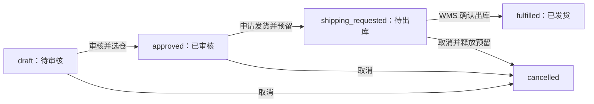

# OMS 状态与接口速查

本页只列当前代码中存在的接口和状态。业务解释、页面操作及规划功能见[章节目录](./README.md)。路由依据 [`orders.py`](../../backend/app/orders.py) 和 [`wms.py`](../../backend/app/wms.py)，字段依据 [`schemas.py`](../../backend/app/schemas.py) 与 [`models.py`](../../backend/app/models.py)。

## 销售订单状态

订单审核不会自动预留库存。申请发货成功会创建一张状态为 `picking` 的出库单并预留库存；仓库确认后出库单变为 `shipped`，订单变为 `fulfilled`。取消仅适用于 `draft`、`approved`、`shipping_requested`。新建售后记录不会改变订单履约状态，也不会自动停止发货；旧版 `after_sale` 状态在全部售后记录处理完后按出库单状态恢复。

## 现有接口与权限

| 用途 | 方法与路径 | 权限 | 关键约束 |
|---|---|---|---|
| 订单列表、详情 | `GET /api/v1/orders`、`GET /api/v1/orders/{id}` | `orders:read` | 按账号店铺范围过滤；列表可用单状态、店铺、创建时间、关键词和分页筛选 |
| 创建订单 | `POST /api/v1/orders` | `orders:write` | 店铺、币种、SKU 启用；币种与店铺一致；同店铺/渠道/来源单号不可重复 |
| 编辑订单 | `PATCH /api/v1/orders/{id}` | `orders:write` | 仅草稿或已审核且无出库单；原因必填；已审核编辑后退回草稿；应付不得低于累计付款 |
| JSON 行导入 | `POST /api/v1/orders/import` | `orders:write` | 最多 1000 行；按来源单号分组；不是文件上传或平台拉单 |
| 审核 | `POST /api/v1/orders/{id}/approve` | `orders:write` | 仅草稿；必须选择启用仓库 |
| 申请发货 | `POST /api/v1/orders/{id}/shipment-request` | `orders:write` | 仅已审核；仓库可用库存足够才创建出库单和预留 |
| 取消 | `POST /api/v1/orders/{id}/cancel` | `orders:write` | 未发货订单；必须填写原因；已预留时释放库存 |
| 确认出库 | `POST /api/v1/shipments/{id}/confirm` | `shipments:write` | 仅 `picking` 出库单；扣减在库与预留，记录追踪号 |
| 订单付款 | `POST/GET /api/v1/orders/{id}/payments` | `payment_records:write/read` | 非已取消订单可登记；付款币种须与订单一致；仅内部记录 |
| 订单售后 | `POST/GET /api/v1/orders/{id}/after-sales` | `after_sales:write/read` | 已审核、待出库或已发货订单；类型为 `return` 或 `refund` |
| 售后分页列表 | `GET /api/v1/after-sales` | `after_sales:read` | 按订单店铺范围过滤，返回来源订单号、客户名及分页总数 |
| 售后处理 | `POST /api/v1/after-sales/{id}/resolve` | `after_sales:write` | 仅 `pending` 可设为 `completed` 或 `rejected`；不执行真实退款/退货入库 |

上述 OMS 接口通过订单所属店铺限制数据可见性。订单审核、申请发货和 WMS 仓库出库接口还检查操作人的 `warehouse_scope`；范围外仓库会被服务端拒绝。

## 客服工单与订单售后

`/api/v1/customer-tickets` 是内部客服任务：`open → in_progress → resolved → closed`，已解决可重开。它可以关联订单，但没有自动创建或完成订单售后。订单售后保存在 `after_sales`，只有 `pending → completed/rejected` 的基础处理。财务退款流水和退货仓库验收目前都没有对应闭环。

## 错误判断

- `401`：未登录或会话无效；`403`：功能权限或创建店铺范围不允许；`404`：记录不存在或不在可见店铺范围。
- `409`：重复来源订单号、已有出库单等冲突；`422`：状态不允许、数据校验失败或库存不足。
- 前端 `/orders` 已接入服务端分页和主要筛选；`/after-sales` 售后列表也使用服务端分页。页面总数来自接口 `total`，不要把当前页行数当作全部记录数。

本页依据静态代码整理，未在本次文档工作中执行接口验收。
