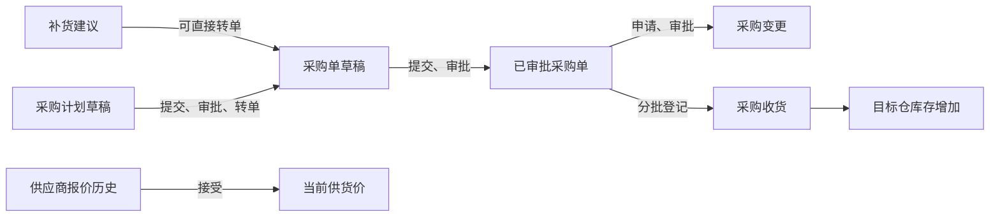

# 采购：怎么买货回来

## 业务链路

采购从“需要补多少”到“货已入仓”分为几条入口：补货建议 `/replenishment`、独立采购计划 `/purchase-plans`、采购单 `/purchase-orders`、采购变更 `/purchase-amendments`、审批工作台 `/purchase-approvals`、收货单 `/receiving`，以及供应商、报价历史和当前供货价。它们在菜单中同属“采购”，代码见 [`scm.py`](../../../backend/app/scm.py)、[`purchase_plans.py`](../../../backend/app/purchase_plans.py)、[`purchase_amendments.py`](../../../backend/app/purchase_amendments.py)、[`supplier_quotes.py`](../../../backend/app/supplier_quotes.py)。

补货建议和采购计划是不同记录：前者由已有的计算接口产生，后者可以人工编制明细并审批。供应商报价保留历史，接受某条报价后更新该供应商与 SKU 的当前供货价；当前供货价本身不是历史报价单。

## 关键规则与接口

| 事项 | 当前规则 | 接口入口 |
|---|---|---|
| 采购计划 | 草稿编辑、提交、审批/驳回，审批后转采购单；重复转单受阻 | `/api/v1/purchase-plans` |
| 采购单 | 草稿可修改；提交后审批；已审批订单不能直接 PATCH 明细 | `/api/v1/purchase-orders` |
| 采购变更 | 对未收货的已审批采购单提出数量、单价、日期或备注变更，保存前后快照与审批意见 | `/api/v1/purchase-amendments` |
| 收货 | 对已审批采购单登记合格与不合格数量；合格量增加目标仓库存，可分批 | `/api/v1/purchase-orders/{id}/receipts` |
| 报价 | 逐条保存报价；接受报价后更新当前供货价与交期 | `/api/v1/supplier-quotes`、`/api/v1/supply-infos` |

## 操作示例

先建立供应商与 SKU 报价；在采购计划中选择供应商、收货仓和 SKU，提交审批后转采购单。采购单提交并通过审批，到货时在收货单录入合格/不合格数量，最后检查采购单收货记录、库存余额和库存流水。若审批后尚未收货且需要改数量，应创建采购变更并等待审批。

## 权限与现状

各独立资源分别使用 `purchase_plans`、`purchase_orders`、`purchase_amendments`、`supplier_quotes`、`supplier_skus`、`replenishment` 的 `read/write` 权限，收货还受采购单及仓库范围规则约束。角色权限以 `/api/v1/permissions` 和实际接口检查为准。

- **已实现：** 计划、订单、审批、变更、分批收货、报价历史、当前供货价与库存联动。
- **部分实现：** 补货计算使用现有规则；审批和收货能完成基础流程，但未覆盖复杂采购预算与质检。
- **尚未实现：** 多供应商自动比价、采购预算控制、采购退货、发票匹配和供应商门户协同。

人工验收时用一笔小数量采购单走完审批和收货，并确认合格量增加库存；再检查重复转单、重复审批和收货后申请明细变更是否被拒绝。文档编写时未执行该操作。
