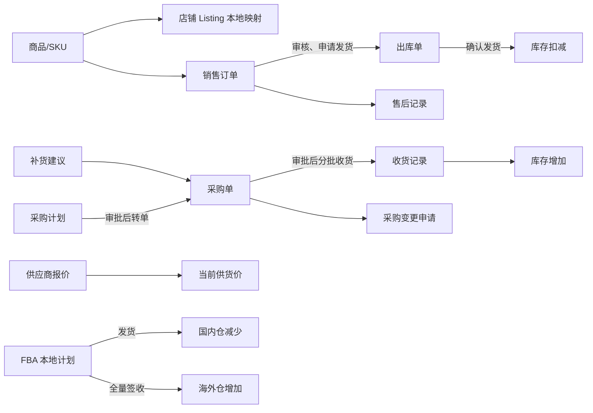

# 单据链：一张图串起来

本篇把当前已经落地的单据关系放在一处。平台自动拉单、物流回传和财务对账尚未接入，所以图从**本地订单或人工采购**开始。

## 阅读单据时看什么

销售链路先看订单状态，再看关联出库单及库存流水。申请发货会预留库存，确认发货才减少在库数量；取消已申请发货的订单会释放预留。采购链路先看采购单审批状态，再看收货记录及目标仓流水；只有合格收货量增加库存。已审批且未收货的采购单改明细要走采购变更申请。FBA 发货与签收只修改本地两个仓库的余额，不代表 Amazon 平台状态已同步。

## 数据入口与权限

订单、采购单、收货、出库和 FBA 分别由 [`orders.py`](../../../backend/app/orders.py)、[`scm.py`](../../../backend/app/scm.py)、[`wms.py`](../../../backend/app/wms.py)、[`fba.py`](../../../backend/app/fba.py) 提供接口。每个接口按自己的 `read/write` 权限检查；店铺与仓库数据范围依业务对象分别生效。库存流水在 `/inventory-txns` 查询。

**已实现：** 上述本地单据状态和库存记账、采购变更快照、工单/售后关联。**部分实现：** 售后记录可处理，但没有完整的退货质检和退款支付回传。**尚未实现：** 从销售订单反查采购补货来源的全局关联图、平台订单自动拉取、跨系统物流轨迹和统一财务结算链。

人工核对一笔业务时，用同一单号依次查看订单或采购单详情、关联执行单据、库存流水和操作日志；不要只凭列表状态判断货或款已经到位。本文编写时未执行人工核对。
